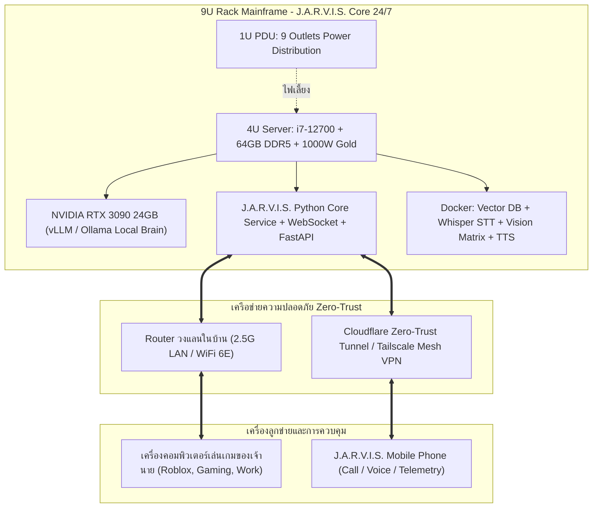
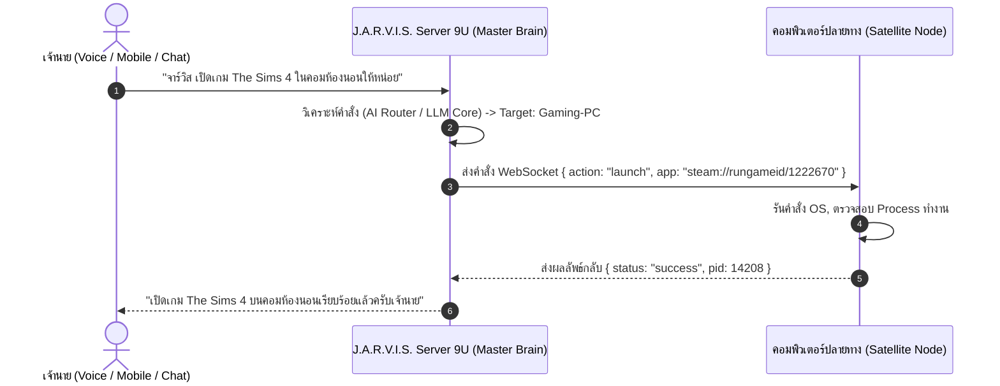

# J.A.R.V.I.S. Hardware Architecture & Mainframe Roadmap
**Phase 10+ Expansion: Dedicated On-Premises AI Mainframe & Zero-Latency Execution**

---

## 🏛️ J.A.R.V.I.S. Home Lab Mainframe & AI Server Specification (9U Rack Build)
สเปกคอมพิวเตอร์เซิร์ฟเวอร์ประจำบ้านสำหรับแยกการประมวลผลระบบสมองกล J.A.R.V.I.S., Local LLM, Vision และงานอัตโนมัติทั้งหมดออกจากเครื่องเล่นเกมหลักของเจ้านาย เพื่อการเปิดทำงานต่อเนื่อง 24 ชั่วโมง 7 วัน (24/7 High-Availability)

### 1. ระบบเคส ตู้แร็ค และการระบายความร้อน (Enclosure & Thermal Infrastructure)
* **ตู้แร็ค (Rack Cabinet):** HYPERLINK 9U ความลึก 60 ซม. (สีดำ, กระจกนิรภัยด้านหน้า, มีช่องร้อยสายบน-ล่าง)
  * *จุดเด่น:* ความลึก 60 ซม. รองรับเคสเซิร์ฟเวอร์ 45 ซม. ได้ลงตัว เหลือช่องว่างด้านหลัง 15 ซม. สำหรับจัดการสายไฟ PDU และทางเดินลมร้อนออก
* **เคสแร็ค (Server Chassis):** COMWORK DX4450B ขนาด 4U (ความลึก 45 ซม., รองรับเมนบอร์ด E-ATX / ATX / M-ATX / ITX, รองรับการ์ดจอยาวสูงสุด 330 มม.)
  * *การใช้งานพื้นที่:* เคส 4U + รางปลั๊ก 1U รวมใช้ 5U เหลือพื้นที่ขยายในตู้แร็คอีก 4U สำหรับติดตั้ง UPS สำรองไฟ, Network Switch หรือ Storage NAS ในอนาคต
* **ชุดระบายความร้อน CPU:** Thermalright AQUA ELITE 240 V3 ARGB Black (ชุดน้ำปิด AIO 240mm หม้อน้ำอะลูมิเนียม พัดลม PWM Dual 120mm)
* **พัดลมระบายความร้อนตู้แร็ค:** GLINK GFA-005 ขนาด 4 นิ้ว (จำนวน 2 ตัว ติดตั้ง Exhaust ด้านบน/หลังตู้แร็ค)
* **รางปลั๊กไฟแร็ค (PDU):** Glink GPDU-09K 1U 9 ช่อง (สายไฟยาว 2 เมตร รองรับกระแสไฟ 16A 3500W พร้อมสวิตช์เบรกเกอร์นิรภัย)

---

### 2. ฮาร์ดแวร์ประมวลผลหลัก (Core Compute Engine)
* **หน่วยประมวลผล (CPU):** Intel Core i7-12700 (LGA 1700, 12 Cores / 20 Threads: 8 P-Cores + 4 E-Cores, Turbo Boost 4.90GHz)
  * *หน้าที่:* สถาปัตยกรรม Hybrid ช่วยแยกงาน โดย P-Cores รับหน้าที่รันอัลกอริทึมซับซ้อน ส่วน E-Cores รันระบบ Background Watchdog, API Server และ Network Protocol แบบประหยัดพลังงาน
  * *ชิปกราฟิกในตัว:* Intel UHD Graphics 770 พร้อมเทคโนโลยี Intel QuickSync ช่วยถอดรหัสวิดีโอและสตรีมกล้องวงจรปิดโดยไม่กินพลังงานการ์ดจอแยก
* **เมนบอร์ด (Motherboard):** MSI B760 GAMING PLUS WIFI (DDR5, ATX Form Factor)
  * *คุณสมบัติ:* ภาคจ่ายไฟ 12+1+1 Duet Rail Power System เสถียรสูงสำหรับเปิดข้ามปี, ช่อง PCIe 4.0 x16 เสริมเกราะเหล็ก Steel Armor, เครือข่าย Realtek 2.5G High-Speed LAN + Wi-Fi 6E / Bluetooth 5.3
* **หน่วยความจำระบบ (RAM):** Kingston FURY Beast DDR5 64GB (32GB x 2) Bus 5200MHz / 6000MHz Dual-Channel (CL36–CL40)
  * *ความจุ:* 64GB เพียงพอต่อการรัน J.A.R.V.I.S. Core, Vector Memory Database (PostgreSQL / ChromaDB), Docker Containers และ Microservices หลายตัวพร้อมกัน โดยยังเหลือสล็อตว่างอีก 2 ช่อง รองรับการอัปเกรดเป็น 128GB
  * *หมายเหตุราคา:* รอจังหวะสต็อกปกติหรือโปรโมชัน (ราคาตลาดจริงประมาณ 7,200 – 8,500 บาท)
* **หน่วยเก็บข้อมูลหลัก (Storage):** WD BLACK SN7100 / SN850X 1TB NVMe M.2 PCIe 4.0 SSD (ความเร็วอ่าน/เขียนระดับ 7,000+ MB/s)
  * *หน้าที่:* ติดตั้งระบบปฏิบัติการ, ฐานข้อมูลความจำระยะยาว, และแคชเก็บน้ำหนักโมเดล Local LLM โหลดเข้า VRAM ได้ภายในเสี้ยววินาที
  * *หมายเหตุราคา:* รอจังหวะสต็อกปกติหรือโปรโมชัน (ราคาตลาดจริงประมาณ 2,800 – 3,500 บาท)
* **พาวเวอร์ซัพพลาย (PSU):** MSI MAG A1000GL PCIE5 (1000W, 80 Plus Gold, Fully Modular)
  * *จุดเด่น:* มาตรฐาน **ATX 3.0 & PCIe 5.0 Native** แท้ รองรับ Power Excursion / Transient Spikes พุ่งพีคได้ถึง 200% (2000W ชั่วขณะ) หมดปัญหา RTX 3090 ไฟกระชากแล้วตัดดับ
  * *ขนาดกะทัดรัด:* ความยาวตัวถังเพียง 140 มม. จัดสายง่ายในเคสแร็ค 4U ไม่เบียดพื้นที่ทางเดินลม
  * *การเชื่อมต่อ:* รองรับหัว 8-Pin PCIe แยกสายเดี่ยวสำหรับการ์ด 3090 และมีหัว 16-Pin 12V-2x6 สีเหลืองรองรับการ์ดจอเจเนอเรชันถัดไป

---

### 3. การ์ดประมวลผลปัญญาประดิษฐ์ (Dedicated AI Neural Processor)
* **หน่วยประมวลผลกราฟิกและ AI (GPU):** NVIDIA GeForce RTX 3090 24GB GDDR6X (384-bit, 10,496 CUDA Cores, 328 3rd Gen Tensor Cores)
  * *งบประมาณเป้าหมาย (มือสอง):* ~23,000 – 28,000 บาท
  * *รุ่นเป้าหมายแนะนำ:* ASUS TUF Gaming, ROG Strix, MSI Suprim X, หรือ EVGA FTW3 Ultra (เน้นรุ่นฮีตซิงก์หนาและการระบายความร้อนเม็ดแรมหลังดีเยี่ยม)
  * *ความสามารถทาง AI บนเครื่อง Local:*
    1. **Local LLM Hosting:** โหลดโมเดลขนาด 70B (4-bit Quantized เช่น Llama 3.3 70B, Qwen 2.5 32B/72B) ประจำการใน VRAM ล้วนๆ เจนข้อความด้วยความเร็ว 40–80+ tokens/sec
    2. **Local Multi-Modal Vision:** รันโมเดลอ่านภาพหน้าจอ/กล้อง (Llama-3.2-Vision หรือ Qwen2-VL) วิเคราะห์ภาพได้แบบ Zero-Latency
    3. **Local Speech-to-Text (STT):** รัน Whisper Large-v3 ถอดเสียงภาษาไทยได้แม่นยำสูงแบบ Real-time โดยไม่เสียโควตา Cloud API

---

### 4. สรุปงบประมาณและสถานะการจัดซื้อ (Bill of Materials - BOM)

| รายการอุปกรณ์ | รายละเอียดสเปก | ร้านค้า / แหล่งที่มา | ประมาณการราคา (บาท) | สถานะ |
|---|---|---|---|---|
| **PSU** | MSI MAG A1000GL PCIE5 1000W Gold | Advice Official (Shopee) | 4,609.- | ในตะกร้า (Flash Sale) |
| **Mainboard** | MSI B760 GAMING PLUS WIFI DDR5 | JIB Official (Shopee) | 4,910.- | ในตะกร้า |
| **CPU** | Intel Core i7-12700 (12C/20T) | Advice Official (Shopee) | 12,140.- | ในตะกร้า |
| **เคสแร็ค** | COMWORK DX4450B ขนาด 4U ลึก 45cm | ComWorkShop (Shopee) | 3,299.- | ในตะกร้า |
| **ตู้แร็ค** | HYPERLINK ตู้ Rack 9U ลึก 60cm | PBA Supply (Shopee) | 2,012.- | ในตะกร้า |
| **ชุดน้ำ CPU** | Thermalright AQUA ELITE 240 V3 ARGB | Thermalright Official | 1,699.- | ในตะกร้า |
| **พัดลมตู้แร็ค** | GLINK GFA-005 4 นิ้ว (2 ตัว) | GLINK Official (Shopee) | 418.- | ในตะกร้า |
| **รางปลั๊ก PDU** | Glink GPDU-09K 1U 9 ช่อง สาย 2m | DKcomputer Mall | 590.- | ในตะกร้า |
| **RAM** | DDR5 64GB (32GB x 2) Bus 5200/6000 | รอสต็อกปกติ / โปรโมชัน | ~7,500.- | รอกดราคาปกติ |
| **Storage** | 1TB NVMe M.2 PCIe 4.0 SSD | รอสต็อกปกติ / โปรโมชัน | ~3,000.- | รอกดราคาปกติ |
| **GPU** | NVIDIA GeForce RTX 3090 24GB GDDR6X | นัดรับมือสอง (กลุ่มเพจการ์ดจอ) | ~25,000.- | กำลังสอดส่องและรอรับ |
| **รวมงบประมาณทั้งระบบ** | | | **~65,177 บาท** | *(สเปกระดับ AI Data Center ขนาดย่อม)* |

---

### 5. แผนผังสถาปัตยกรรมการเชื่อมต่อ (System Topology & Service Roles)

* **ภาระงานของเครื่องเล่นเกมเจ้านาย (Gaming PC):** ลดเหลือ 0% ไม่ต้องแบกรับการโหลดโมเดล AI ในเครื่องอีกต่อไป เล่นเกมได้เต็มประสิทธิภาพ 100% ไม่มีปัญหา RAM เต็มหรือ FPS ดรอป
* **ภาระงานของเครื่อง Server (9U Mainframe):** สแตนด์บายรับคำสั่งผ่าน REST API / WebSockets ตลอดเวลา รันระบบวิเคราะห์ เฝ้าหน้าจออัตโนมัติ (Anti-AFK Keeper) และคอยรับสายจากมือถือเจ้านายได้จากทุกที่ทั่วโลก

---

### 6. สถาปัตยกรรมควบคุมคอมพิวเตอร์ข้ามเครื่อง (Remote Master-Satellite Control Architecture)
เพื่อรองรับการที่ **J.A.R.V.I.S. Mainframe (Server 9U)** คอยสั่งการและควบคุมคอมพิวเตอร์เครื่องอื่นของเจ้านาย (เช่น เครื่อง Gaming PC ในห้องนอน หรือ Laptop พกพา) ได้แบบเบ็ดเสร็จสมบูรณ์

#### คุณสมบัติของโปรแกรมตัวแทน (JARVIS Satellite Node):
1. **กินทรัพยากรต่ำมาก (<25MB RAM, 0% CPU Idle):** รันเป็น Background Service เงียบๆ พอบูตเครื่องลูกปุ๊บ จะต่อท่อสัญญาณ WebSocket เข้าหา Server หลักทันที
2. **การสั่งการระบบปฏิบัติการและเกม (OS & Game Automation):**
   * เปิด/ปิดแอปพลิเคชัน (Steam, Discord, Roblox, Chrome)
   * ปรับระดับเสียงลำโพง (Volume Up/Down/Mute)
   * สั่งล็อกหน้าจอ (Lockdown), Sleep, หรือ Shutdown จากระยะไกล
3. **การควบคุมเมาส์และคีย์บอร์ด (Agentic GUI Control):**
   * Server สามารถส่งพิกัด `(x, y)` ไปให้เครื่องลูกคลิกเมาส์ เลื่อนเมาส์ ลากวัตถุ หรือพิมพ์ข้อความภาษาไทย/อังกฤษ ได้เสมือนมีคนนั่งหน้าเครื่อง
4. **สายตาส่งกลับ (Remote Screen Streaming & Vision Feedback):**
   * เครื่องแม่สามารถสั่งให้เครื่องลูกถ่ายภาพหน้าจอ (Screen Grab) ส่งกลับมาแบบเรียลไทม์ เพื่อให้โมเดล Vision วิเคราะห์ว่าโปรแกรมเรนเดอร์เสร็จหรือยัง หรือบอทเกมหลุดหรือไม่
5. **ความปลอดภัยเครือข่าย (Zero-Trust Security):**
   * เชื่อมต่อผ่าน Local LAN วงในบ้าน (< 3ms Latency) หรือผ่าน Tailscale Mesh VPN เมื่ออยู่นอกบ้าน พร้อมระบบ Secret Token Handshake ป้องกันบุคคลภายนอกแทรกแซง

---

### 7. โครงสร้างไฟล์พิมพ์เขียวระบบควบคุมข้ามเครื่อง (Draft Architecture Files)

| ไฟล์โมดูล | ตำแหน่งที่ตั้ง | หน้าที่การทำงาน |
|---|---|---|
| **`jarvis_node_manager.py`** | `modules/` (บน Server แม่) | เป็นตัวแม่คอยรับการเชื่อมต่อจากคอมพิวเตอร์หลายๆ เครื่องในบ้าน, จัดการรายชื่อ Node, ส่งคำสั่งกระจายงาน |
| **`jarvis_satellite_node.py`** | `modules/` (ก๊อปปี้ไปรันบนคอมปลายทาง) | เป็นตัวลูก รันบนเครื่องเป้าหมาย คอยรับคำสั่งคลิกเมาส์, พิมพ์คีย์บอร์ด, เปิดโปรแกรม, และแคปหน้าจอส่งกลับ |

---

### 8. การวิเคราะห์ช่องว่างฮาร์ดแวร์และการปลดล็อกขีดความสามารถ (Hardware Gap Analysis & Capability Unlock Roadmap)

การเปรียบเทียบระหว่าง **คอมพิวเตอร์ปัจจุบัน (โน้ตบุ๊กทดสอบระบบ)** กับ **เซิร์ฟเวอร์หลัก 9U Rack (ที่จะประกอบ)** เพื่อระบุสิ่งที่เครื่องปัจจุบันติดขีดจำกัด และต้องดำเนินการย้าย/อัปเกรดทันทีเมื่อประกอบเสร็จ

#### ตารางเปรียบเทียบสเปกฮาร์ดแวร์ (Current vs. 9U Rack Server):

| องค์ประกอบ | เครื่องปัจจุบัน (Laptop ที่รันอยู่) | J.A.R.V.I.S. Server 9U Rack | ผลลัพธ์การอัปเกรด |
|---|---|---|---|
| **CPU** | 4 Cores / 8 Threads (Intel Mobile) | **i7-12700 (12 Cores / 20 Threads)** | ประมวลผลเร็วขึ้น 3.5 เท่า, แยก P/E-Core รัน Background ไม่หน่วง |
| **RAM** | **7.87 GB DDR4** (แตะ 80-90% ประจำ) | **64 GB DDR5 5200/6000MHz** | เพิ่มความจุ RAM ขึ้น **8 เท่า**, แบนด์วิดท์เร็วขึ้นเท่าตัว |
| **GPU (AI Engine)** | **NVIDIA GeForce MX250** (VRAM 2.0 GB) | **NVIDIA RTX 3090 24GB GDDR6X** | VRAM เพิ่มขึ้น **12 เท่า**, มี 328 Tensor Cores สำหรับ Deep Learning |
| **ระบบระบายความร้อน** | พัดลมโน้ตบุ๊กเดี่ยว (เสี่ยง Thermal Throttling) | ชุดน้ำ AIO 240mm + พัดลมคู่ 4 นิ้วในแร็ค | อุณหภูมิเสถียร 55-65°C แม้รันฟูลโหลด 24 ชั่วโมง |
| **การทำงานต่อเนื่อง** | เสี่ยงแบตเตอรี่บวมหากเปิดข้ามสัปดาห์ | **24/7/365 High-Availability** | สแตนด์บายตลอดเวลา ไม่มีหลับ ไม่มีพัง |

---

#### 6 ขีดความสามารถที่เครื่องปัจจุบันทำไม่ได้ และต้องปลดล็อกบน Server 9U:

1. **การรัน Local LLM ขนาดใหญ่ (70B / 32B) ในเครื่องแบบ 100% Offline:**
   * *ปัจจุบัน:* VRAM 2GB โหลดได้แค่โมเดลจิ๋ว 1B-3B หรือ JarvisCore 3.2M ต้องพึ่งพา Groq API ตลอดเวลา หากอินเทอร์เน็ตหลุดหรือติด Rate Limit จาร์วิสจะหยุดทำงานทันที
   * *เมื่อมี Server:* โหลดโมเดลยักษ์ **Llama 3.3 70B** หรือ **Qwen 2.5 32B** เข้า VRAM 24GB เพียวๆ ทำงานออฟไลน์ได้ 100% ไม่พึ่งพาอินเทอร์เน็ต ตอบไว 40–80 tokens/sec
2. **การฟังเสียงภาษาไทยระดับสมบูรณ์แบบ (Local Whisper Large-v3 Real-Time):**
   * *ปัจจุบัน:* Whisper Large-v3 ต้องใช้ VRAM ราว 6–8GB เครื่องปัจจุบันรันไม่ได้ ต้องใช้รุ่น Base เล็กๆ ซึ่งฟังภาษาไทยเพี้ยนบ่อย
   * *เมื่อมี Server:* รัน **Whisper Large-v3** บน RTX 3090 ได้แบบเรียลไทม์ (Latency < 200ms) ถอดภาษาไทยแม่นยำ 100% ทันทีที่เจ้านายพูดจบประโยค
3. **สายตา Vision ตรวจสอบหน้าจอและเกม 60 FPS (Continuous Real-Time Vision):**
   * *ปัจจุบัน:* ต้องแคปภาพนิ่งส่งไปให้ Gemini Vision บนคลาวด์ ซึ่งติดโควตา API ไม่สามารถสตรีมมิ่งตรวจจับจอภาพตลอดเวลาได้
   * *เมื่อมี Server:* รันโมเดล **Qwen2-VL** หรือ **Llama-3.2-11B-Vision** บนการ์ด 3090 เฝ้าดูหน้าจอและกล้องวงจรปิดแบบสตรีมมิ่งต่อเนื่อง 24 ชั่วโมง โดยไม่เสียค่าโควตาแม้แต่บาทเดียว
4. **การเปิดทำงานต่อเนื่อง 24 ชั่วโมง (24/7 Continuous Standby & Remote Automation):**
   * *ปัจจุบัน:* โน้ตบุ๊กเปิดทิ้งไว้ตลอดเวลาไม่ได้ ถ้าเจ้านายพับฝา พกเครื่องไปข้างนอก หรือปิดเครื่องนอน จาร์วิสจะดับทันที (บอทเกมหลุด, โทรศัพท์ติดต่อไม่ติด)
   * *เมื่อมี Server:* Server ประจำการในตู้แร็คตลอดเวลา แม้เจ้านายปิดคอมเล่นเกม จาร์วิสก็ยังคงตื่นอยู่ คอยบอทเกม เฝ้าระบบ แบคอัพไฟล์ และรับสายจากมือถือเจ้านายได้ทุกที่ทั่วโลก
5. **ฐานข้อมูลความจำไร้ขีดจำกัด (Vector Database & Semantic Graph Search):**
   * *ปัจจุบัน:* RAM 8GB ไม่พอสำหรับการรัน PostgreSQL + Vector Database (pgvector / ChromaDB) ร่วมกับแอปอื่นๆ จึงต้องเก็บเป็น JSON/TXT ธรรมดา
   * *เมื่อมี Server:* RAM 64GB DDR5 เปิดพื้นที่ให้รัน Vector Database ขนาดใหญ่ สามารถจดจำเอกสาร ตำราเรียน ประวัติการแชททั้งหมด ค้นหาความจำในอดีตได้ภายในเวลาไม่เกิน 5ms
6. **การสเกลสมอง In-House (JarvisCore) สู่ระดับ 100M - 500M Parameters:**
   * *ปัจจุบัน:* เทรนได้จำกัดที่ 3.24M Parameters (Context 256) เพราะเกือบเต็ม VRAM 2GB ของ MX250 แล้ว
   * *เมื่อมี Server:* สเกลสมอง JarvisCore ขยายขนาดขึ้นเป็น **100M - 500M Parameters** พร้อม Context 2048+ tokens และ Fine-tune บทสนทนาขนาดยักษ์ได้รวดเร็วบน Tensor Cores ของ RTX 3090

---

### 9. สถาปัตยกรรมความเร็วแสง (High-Speed Local AI) & ระบบบ้านอัจฉริยะ (Home Assistant Co-Host)

#### 9.1 โครงสร้าง AI Engine สายความเร็วสูงสุด (Zero-Latency Local Engine):
* **เครื่องมือรันหลัก:** ใช้ **Ollama** ตามมาตรฐานเดิมของระบบ J.A.R.V.I.S. (ผ่านพอร์ต `http://localhost:11434` Plug-and-Play ไม่ต้องแก้โค้ดสักบรรทัด)
* **โมเดลเรือธง (Flagship Model):** **`Qwen 2.5 32B`**
  * ขนาดไฟล์: ~19 GB (โหลดเข้า VRAM 24GB ของ RTX 3090 ได้ 100% เพียวๆ ไม่ต้องพึ่งพา RAM เครื่อง)
  * ความเร็วประมวลผล: **45 – 65 tokens / วินาที**
  * เวลาตอบคำแรก (TTFT): **~0.2 – 0.3 วินาที** (ตอบกลับแทบจะทันทีในพริบตาเดียว)
* **โมเดลปฏิกิริยาตอบสนองด่วน (Reflex Sub-Model):** **`Qwen 2.5 7B` / `Llama 3.2 3B`**
  * สำหรับคำสั่งสั้นๆ เช่น เปิดไฟ, ปรับเสียง, สั่งเปิดเกม, ทักทาย
  * ความเร็ว: **120 – 150+ tokens / วินาที** (ตอบภายใน 0.05 วินาที)
* **ระบบ Audio Chunk Streaming:** เสียงตอบรับภาษาไทย (TTS) จะเริ่มพูดตั้งแต่คำแรกที่ประมวลผลเสร็จ (ภายใน 0.3 วินาที) โดยไม่ต้องรอให้เจนจบทั้งย่อหน้า ตัดปัญหา Dead Air

#### 9.2 การรันระบบบ้านอัจฉริยะ (Home Assistant Co-Existence):
* **รูปแบบการติดตั้ง:** รัน Home Assistant OS (HAOS) ผ่าน **Oracle VirtualBox** หรือ **Windows Hyper-V** บนเครื่อง Server 9U ควบคู่กับ J.A.R.V.I.S.
* **การจัดสรรทรัพยากร (Resource Allocation):**
  * CPU: แบ่งให้ VM เพียง 2 Cores (คงเหลือให้ J.A.R.V.I.S. อีก 18 Threads)
  * RAM: แบ่งให้ VM เพียง 4 GB (คงเหลือให้ J.A.R.V.I.S. อีก 60 GB หรือ 94%)
  * GPU: 0 GB (Home Assistant ไม่ใช้การ์ดจอ ยก VRAM 24GB ให้ AI ทั้งหมด)
* **การควบคุมแบบ Zero Latency Localhost:**
  * J.A.R.V.I.S. สั่งการ Home Assistant ผ่าน Local Loopback `http://127.0.0.1:8123` ด้วยฟังก์ชัน `call_home_assistant_service` ที่มีอยู่ในระบบแล้ว
  * ควบคุมไฟ แอร์ ประตู ปลั๊กไฟ และเซ็นเซอร์ในบ้านได้ทันที 100% แม้อินเทอร์เน็ตภายนอกจะหลุด

---
*บันทึกสถานะ: ได้รับการอนุมัติสเปก สถาปัตยกรรมควบคุมข้ามเครื่อง ช่องว่างฮาร์ดแวร์ และโครงสร้างความเร็วแสงร่วมกับ Home Assistant เรียบร้อย*  
*ผู้อนุมัติ: Mainframe Commander / System Owner*
