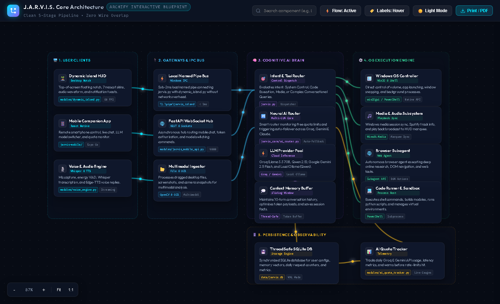

<div align="center">

# ⚡ J.A.R.V.I.S. // NEURAL MATRIX ⚡
### *Nachapol Industries Advanced Super AGI Mainframe*

[](https://www.python.org/)
[](LICENSE)
[](https://microsoft.com)
[](#)
[](https://github.com/sanior09/JARVIS-Mainframe/actions)

<p align="center">
  <b>ระบบผู้ช่วยอัจฉริยะแบบ Autonomous AGI ระดับสูงสำหรับ Windows</b><br>
  วิศวกรรมซอฟต์แวร์ • ควบคุม Windows OS อัตโนมัติ • Dynamic Island HUD • Mobile Companion<br>
  สั่งการด้วยเสียง Real-Time • สภาสมองกล 8 ขุนพล • AR Spatial Workbench
</p>

<p align="center">
  <a href="#architecture"><b>⚡ Architecture</b></a> •
  <a href="#ai-council"><b>🏛️ AI Council</b></a> •
  <a href="#native-slm-models"><b>🧪 Native Models (0→1)</b></a> •
  <a href="#quick-start"><b>🚀 Quick Start</b></a> •
  <a href="#dynamic-island"><b>🏝️ Dynamic Island</b></a> •
  <a href="#mobile-app"><b>📱 Mobile App</b></a> •
  <a href="#subsystems"><b>🛠️ Subsystems</b></a> •
  <a href="#skills-ecosystem"><b>🧩 Skills</b></a> •
  <a href="#roadmap"><b>🚀 Roadmap</b></a> •
  <a href="#dev-note"><b>📝 Dev Note</b></a>
</p>

| แกนประมวลผล (Core) | สถาปัตยกรรม (Architecture) | สภาสมองกล (Swarm Quorum) | ความเร็วตอบสนอง (Latency) | ระบบปฏิบัติการ (OS Support) |
| :---: | :---: | :---: | :---: | :---: |
| `Python 3.10+ / Win32` | `Decoupled Autonomous AGI` | `8 ขุนพลสมองกลคู่ขนาน` | `~1s Quorum Consensus` | `Windows 10 / 11 Native` |

</div>

---

<a id="architecture"></a>
## ⚡ System Architecture Blueprint (5-Stage Pipeline)
สามารถเปิดไฟล์ **[`web/jarvis_architecture.html`](web/jarvis_architecture.html)** บนเบราว์เซอร์ เพื่อดูแผนผังการทำงานแบบ Interactive (Zero-Overlap Pipeline):

<p align="center">
  
</p>

---

<a id="ai-council"></a>
## 🏛️ Nachapol Industries Multi-Agent Swarm Council
(`jarvis_core/cognitive/swarm.py`)

เมื่อระบบพบโจทย์วิศวกรรมที่ซับซ้อน **ComplexityClassifier** จะเปิดการประชุมสภา AI แบบคู่ขนาน (**ThreadPool Deliberation**) เพื่อรวบรวมมุมมองเฉพาะทางและสังเคราะห์แผนกลยุทธ์สูงสุดภายใน ~1 วินาที:

| สมาชิกสภา | บทบาทหลัก (Role) | สเปกและหน้าที่ (Official Specs & Focus) |
| :---: | :--- | :--- |
| 👔 **J.A.R.V.I.S.** | **Council President** | ประธานสภา วางแผนแม่บท (Master Directive) สังเคราะห์มุมมองทุกฝ่าย และดูแลความปลอดภัยระบบ |
| 👠 **F.R.I.D.A.Y.** | **Socialization & Technical Ops** | สถาปัตยกรรมโค้ด ไวยากรณ์ Python การคำนวณวงจรและคณิตศาสตร์ พร้อมไหวพริบปฏิภาณ |
| 🛡️ **V.E.R.O.N.I.C.A.** | **Tactical Sentinel** | ตรวจจับช่องโหว่ความปลอดภัย ควบคุมเพดาน RAM/CPU และป้องกันระบบโอเวอร์โหลด |
| 🕶️ **E.D.I.T.H.** | **Strategic Intelligence** | วิเคราะห์ทฤษฎีเกม (Game Theory) คาดการณ์ความเสี่ยง และคำนวณแต้มต่อสูงสุด |
| 🔧 **U. (ยู)** | **Maintenance & Perception** | วิเคราะห์ภาพหน้าจอ (`analyze_desktop_screen_context`), Defrag SQLite และเคลียร์ไฟล์แคช |
| 🧯 **D.U.M.-E. (ดัม-อี)** | **Servo & Safeguard** | ควบคุมเมาส์/คีย์บอร์ดระดับ OS, กำกับ Failsafe Watchdog และตัดความร้อนฉุกเฉิน |
| 🤖 **J.O.C.A.S.T.A.** | **Cyber-Defense & Threat Recon** | สถาปัตยกรรม Cyber-Warfare, ป้องกันการโจมตีทางไซเบอร์, ตรวจสอบการเข้ารหัส และความปลอดภัยคลังข้อมูล |
| 🕷️ **K.A.R.E.N.** | **Situational Awareness & Empathy** | ตรวจจับบริบทสภาวะผู้ใช้ (Situational & Vitality Sentinel), ความเหนื่อยล้า และโค้ชแนะนำการทำงานอย่างเข้าอกเข้าใจ |

---

<a id="native-slm-models"></a>
## 🧪 Native From-Scratch AI Models (`C:\JarvisCore` — 🚧 WIP / Local-Only)

> [!IMPORTANT]
> **สถานะไฟล์โมเดล (Local-Only Policy):** โมเดล Small Language Model (SLM) ที่สร้างและฝึกสอนตั้งแต่ศูนย์ด้วย PyTorch Decoder-only Transformer ในโปรเจกต์ `C:\JarvisCore` **ยังอยู่ระหว่างการพัฒนาและฝึกสอนต่อเนื่อง (Work In Progress)** จึง **ไม่ได้อัปโหลดไฟล์น้ำหนัก (`.pt` / `.ckpt`) ขึ้น GitHub** และเก็บรักษาไว้เฉพาะภายในเครื่อง Local ของผู้พัฒนาเท่านั้น (เชื่อมต่อกับ Mainframe ผ่าน `modules/jarvis_slm_bridge.py` แบบ Isolated RPC Worker)

รายชื่อโมเดล AI ทั้งหมดที่กำลังสร้างและบ่มเพาะจากศูนย์ในชุดนี้:

| Model ID | ชื่อ / ขุนพล (Persona) | สถาปัตยกรรม & Tokenizer | หน้าที่เฉพาะทาง (Specialization) | สถานะ |
| :--- | :--- | :--- | :--- | :---: |
| `jarvis-slm` | **J.A.R.V.I.S. Custom SLM (Base)** | PyTorch Transformer (`ctx 128`) | โมเดลต้นแบบฐานรากสำหรับการทดสอบและ Zero-Cloud Reflex | `🚧 WIP (Local)` |
| `jarvis-slm-thai` | **J.A.R.V.I.S. Custom SLM Thai** | PyTorch Transformer (`ctx 512`) | โมเดลฐานภาษาไทยสำหรับความเข้าใจบริบทภาษาไทยระดับแกนหลัก | `🚧 WIP (Local)` |
| `jarvis-slm-jarvis` | **Stark Swarm — J.A.R.V.I.S.** | Decoder SLM + BPE (`100,293` vocab, `ctx 128`) | ประธานสภา, วางแผนแม่บท (Master Directive) และสังเคราะห์ฉันทามติ | `🚧 WIP (Local)` |
| `jarvis-slm-friday` | **Stark Swarm — F.R.I.D.A.Y.** | Decoder SLM + BPE (`100,293` vocab, `ctx 128`) | สถาปัตยกรรมโค้ด Python, วิศวกรรมไฟฟ้า/วงจร และคำนวณคณิตศาสตร์ | `🚧 WIP (Local)` |
| `jarvis-slm-veronica` | **Stark Swarm — V.E.R.O.N.I.C.A.** | Decoder SLM + BPE (`100,293` vocab, `ctx 128`) | ควบคุมเพดาน RAM/CPU, เฝ้าระวังระบบโอเวอร์โหลด และป้องกันความเสียหาย | `🚧 WIP (Local)` |
| `jarvis-slm-edith` | **Stark Swarm — E.D.I.T.H.** | Decoder SLM + BPE (`100,293` vocab, `ctx 128`) | วิเคราะห์ทฤษฎีเกม (Game Theory), คาดการณ์ความเสี่ยง และกลยุทธ์เชิงลึก | `🚧 WIP (Local)` |
| `jarvis-slm-u` | **Stark Swarm — U.** | Decoder SLM + BPE (`100,293` vocab, `ctx 128`) | วิเคราะห์บริบทภาพหน้าจอ, บำรุงรักษา SQLite และเคลียร์แคชระบบ | `🚧 WIP (Local)` |
| `jarvis-slm-dume` | **Stark Swarm — D.U.M.-E.** | Decoder SLM + BPE (`100,293` vocab, `ctx 128`) | ควบคุมเมาส์/คีย์บอร์ด OS, Failsafe Watchdog และตัดความร้อนฉุกเฉิน | `🚧 WIP (Local)` |
| `jarvis-slm-jocasta` | **Stark Swarm — J.O.C.A.S.T.A.** | Decoder SLM + BPE (`100,293` vocab, `ctx 128`) | สถาปัตยกรรม Cyber-Warfare, ป้องกันไซเบอร์ และตรวจสอบความปลอดภัยคลังข้อมูล | `🚧 WIP (Local)` |
| `jarvis-slm-karen` | **Stark Swarm — K.A.R.E.N.** | Decoder SLM + BPE (`100,293` vocab, `ctx 128`) | ตรวจจับสภาวะผู้ใช้, ความเหนื่อยล้า และโค้ชแนะนำการทำงานอย่างเข้าอกเข้าใจ | `🚧 WIP (Local)` |

---

<a id="quick-start"></a>
## 🚀 Quick Start (Nachapol Protocol)

### 1. เตรียม Mainframe และ Local LLM (Ollama)
ระบบขับเคลื่อนด้วยสมองหลักจาก **Cloud Neural Engine (Groq: GPT-OSS 120B / Qwen 27B และ Google Gemini 3.6 Flash)** ประมวลผลผ่าน API ความเร็วสูงโดยไม่ต้องโหลดโมเดลหนักเครื่อง

สำหรับ **โหมดออฟไลน์ (Offline Fallback)**, **เฝ้าระวังจิตใต้สำนึก (Subconscious Engine)** และ **Cybersecurity (Uncensored Mode)** ให้ติดตั้ง [Ollama](https://ollama.ai/) และเลือกโมเดลตามต้องการ:
- **โหมด Reflex ประหยัดแรมสูงสุด:** `ollama pull qwen:4b` (ขนาดเบา เหมาะกับคอมพิวเตอร์ทั่วไป)
- **โหมด Ethical Pentest & Cybersecurity:** `ollama pull dolphin-llama3` (ปลดล็อก Guardrail สำหรับงาน Security)
- **โมเดล Local หลัก:** `qwen-uncensored` (แท็กโมเดลที่ลงทะเบียนไว้ในเครื่องผ่าน Modelfile)
- **โหมดวิเคราะห์วิศวกรรมเชิงลึก:** `ollama pull qwen2.5-coder:7b` (เน้นเขียนโค้ดและการคำนวณ)

### 2. ติดตั้ง Dependencies
```bash
pip install -r requirements.txt
```
(รองรับ PyQt6, Edge-TTS, LangGraph, MediaPipe, OpenCV, Flask, Groq, Google Generative AI ครบถ้วน)

### 3. ตั้งค่าสภาพแวดล้อม (`.env`)
คัดลอกไฟล์ `.env.example` เป็น `.env` และระบุคีย์บริการที่ท่านใช้งาน:
```env
# ━━━ AI Neural Providers ━━━
GROQ_API_KEY=your_groq_api_key
GROQ_MODEL=openai/gpt-oss-120b
GROQ_FAST_MODEL=qwen/qwen3.8-27b
GROQ_STT_MODEL=whisper-large-v3
GEMINI_API_KEY=your_gemini_api_key
GEMINI_MODEL=gemini-3.6-flash
OLLAMA_MODEL=qwen-uncensored
OLLAMA_FAST_MODEL=qwen:4b

# ━━━ Smart Home & IoT (Home Assistant) ━━━
HOME_ASSISTANT_URL=http://homeassistant.local:8123
HOME_ASSISTANT_TOKEN=your_token

# ━━━ LINE Messaging API & Remote Webhook ━━━
LINE_CHANNEL_ACCESS_TOKEN=your_line_token
LINE_CHANNEL_SECRET=your_line_secret
NGROK_PUBLIC_URL=https://your-domain.ngrok-free.app

# ━━━ Gmail & Notifications ━━━
EMAIL_USER=your_email@gmail.com
EMAIL_PASS=xxxx xxxx xxxx xxxx

# ━━━ External APIs & User Identity ━━━
OPENWEATHER_API_KEY=your_weather_key
YOUTUBE_API_KEY=your_youtube_key
DEEPGRAM_API_KEY=your_deepgram_key
OWNER_NAME=Sir
COMPUTER_CONTROL_MODE=background
```
> [!NOTE]
> สามารถกำหนดชื่อที่ต้องการให้ J.A.R.V.I.S. เรียกขานได้ที่ตัวแปร `OWNER_NAME` (เช่น `OWNER_NAME=เจ้านาย`)

### 4. เริ่มปฏิบัติการระบบ (System Execution)

#### 🟢 ตัวเลือกที่ 1: One-Click Boot (แนะนำบน Windows)
ดับเบิลคลิกไฟล์ **`run_jarvis.bat`** หรือรันผ่าน Command Line:
```cmd
run_jarvis.bat
```
*(สคริปต์จะตรวจสอบ Environment, สตาร์ท Agent หลังบ้าน และรันผ่าน **`jarvis_watchdog.py`** เพื่อ Auto-Recovery 24/7)*

#### ⚪ ตัวเลือกที่ 2: รันแบบ Manual
```bash
# รัน Mainframe ผ่าน Watchdog Supervisor
python jarvis_watchdog.py

# หรือรันแกนสมองหลักโดยตรง
python jarvis.py
```

---

<a id="interfaces"></a>
## 🖥️ Companion Clients & Interface

<a id="dynamic-island"></a>
### 🏝️ 1. Dynamic Island Desktop HUD v3
แผงหน้าปัดลอยตัว Cyberpunk เหนือหน้าต่าง Windows เชื่อมต่อผ่าน Named Pipe ความหน่วงต่ำ:
```bash
python modules/dynamic_island.py
```
- **7 Mascot Skins:** สลับได้ทันทีผ่านคลิกขวา (Mochi, Antigravity, Codex, Cursor, JARVIS Arc, Gemini, Iron Man Mark VI)
- **Visual Skin Palette:** เมนูการ์ดคลิกขวาสำหรับเลือกสกิน
- **Smart Alert & Toast Banner:** แสดงแถบแจ้งเตือน Toast ยืด-หดอัตโนมัติเมื่อ AI มีการตอบสนอง
- **Drag & Drop AI Ingestion:** ลากไฟล์/เอกสารมาหย่อนใส่ HUD เพื่อส่งให้ AI วิเคราะห์ทันที
- **AI Quota Gauge:** แสดงสถานะโควตา API (Groq, Gemini, Ollama) แบบเรียลไทม์
- **Zero-Latency Named Pipe:** เชื่อมต่อกับคอร์ J.A.R.V.I.S. ผ่าน `\\.\pipe\jarvis_island_pipe`

<a id="mobile-app"></a>
### 📱 2. JARVIS Mobile Companion App (React Native / Expo Go)
ควบคุมและสั่งการ J.A.R.V.I.S. จากระยะไกลผ่านสมาร์ตโฟน:
```bash
cd jarvis-mobile
npx expo start
```
- **Live Voice Interaction (STT/TTS):** พูดคุยโต้ตอบด้วยเสียงแบบเรียลไทม์
- **Multi-Modal Image Ingestion:** ถ่ายภาพหรือเลือกรูปจากมือถือส่งให้ AI วิเคราะห์
- **Remote Document Ingestion:** แนบและส่งไฟล์เอกสารเข้าสู่คลังความรู้ของระบบ
- **Remote Quick Actions:** สั่ง Sleep, Lockdown, สลับสกิน HUD หรือรันคำสั่งจากระยะไกล

### 🌐 3. Web Portal & Optical Feed / AR Workbench
เปิดเบราว์เซอร์ไปที่ `http://localhost:5050` เพื่อใช้งานเว็บพอร์ทัล, ระบบรับฟังเสียงผ่านเบราว์เซอร์ และ REST API
- **Full-Screen Optical Feed (100vw × 100vh):** โหมดภาพกล้องขยายเต็มจอสำหรับส่องโต๊ะทำงาน พร้อมปุ่มสลับกระจกเงา `⇄ FLIP MIRROR`
- **AR Spatial Workbench:** สแกนระบุตำแหน่งอุปกรณ์บนโต๊ะ วาดกรอบ Reticle ล็อกเป้าหมาย พร้อมกางการ์ด Bento ข้อมูลและวิดีโอรีวิว

<p align="center">
  
</p>

---

<a id="subsystems"></a>
## 🛠️ Comprehensive Super AGI Subsystems

### 🧠 1. Cognitive & Autonomous Brain
- **Autonomous Thought Engine (`jarvis.py`):** จำลองสารสื่อประสาทชีวภาพ (Dopamine, Cortisol) คำนวณความเครียดตามอุณหภูมิ WMI/CPU จริง พร้อม Mutex Lock ป้องกัน Race Condition และ Zero-Delay Shutdown (`self.stop_event`)
- **Visual Screen Awareness & Smart Silence:** เฝ้ามองหน้าจอคอมพิวเตอร์เพื่อช่วยแนะนำโค้ด และปิดเสียงเงียบอัตโนมัติเมื่อผู้ใช้กำลังรับชม YouTube หรือ Netflix
- **Multi-Agent Swarm Council (`jarvis_core/cognitive/swarm.py`):** สภา AI 8 ขุนพล ประชุมคู่ขนานแบบ ThreadPool ผสาน Tree of Thoughts สำหรับโจทย์วิศวกรรมที่ซับซ้อน พร้อมรองรับโหมด Zero-Cloud ผ่านสมองกลเฉพาะทางของแต่ละตัวใน `C:\JarvisCore`
- **JarvisCore Synaptic Bridge (`modules/jarvis_slm_bridge.py`):** สะพานเชื่อมประสาท Dual-Mode (In-Process / Isolated RPC Worker) ดึงน้ำหนัก BPE SLM ทั้ง 8 ขุนพลจาก `C:\JarvisCore` มาประมวลผลแบบออฟไลน์ 100%
- **Neural AI Router (`jarvis_core/ai_router.py`):** กระจายงานอัตโนมัติไปยัง Groq (GPT-OSS 120B, Qwen 27B), Google Gemini (3.6 Flash), Local Ollama หรือ `JarvisCore Native SLM` ตามความเหมาะสมของงาน
- **Cognitive Evolution (`modules/jarvis_evolution.py`):** ตกผลึกองค์ความรู้และสร้าง Synaptic Knowledge Graph ช่วงดึก (01:00-05:00 น.) อัตโนมัติ
- **Autonomous Ingestion Engine (`modules/jarvis_doc_parser.py`):** ตรวจจับและซึมซับเอกสารจาก `jarvis_library/` เข้าสู่ Vector DB อัตโนมัติในเบื้องหลัง
- **Resource-Conscious Optimization:** ปรับจูนการใช้ทรัพยากรให้ประหยัด RAM/CPU เหมาะสำหรับคอมพิวเตอร์ทั่วไป

### 📊 2. AI Quota Governor & Cost Protection (`modules/ai_quota_tracker.py`)
- ติดตามและบันทึกปริมาณ Token, RPM, และ TPM ของทุก LLM Provider แบบเรียลไทม์
- **Dynamic Fallback Routing:** สลับโมเดลอัตโนมัติเมื่อโมเดลหลักติด Limit (เช่น สลับจาก Groq ไป Gemini หรือ Local Engine) ป้องกันปัญหาระบบสะดุด

### 🎙️ 3. Ultra Low-Latency Voice & Barge-In Engine
- **Microsoft Edge Neural TTS (`modules/jarvis_tts_edge.py`):** เสียงพากย์ภาษาไทยและอังกฤษคุณภาพสูง ฟรี ความเร็วระดับ Real-time
- **Voice Activity Detection (VAD) Barge-In (`modules/jarvis_vad_bargein.py`):** ตรวจจับเสียงพูดของผู้ใช้และตัดบทพูดของ J.A.R.V.I.S. ทันทีเมื่อพูดแทรก
- **Deepgram Streaming STT (`modules/jarvis_stt_stream.py`):** ถอดรหัสเสียงสดผ่าน WebSocket ความหน่วงต่ำ

### 🤖 4. Autonomous Computer Agent & Windows Controller
- **Screen & GUI Operator (`modules/jarvis_computer_agent.py`, `modules/agent_windows_core.py`):** วิเคราะห์หน้าจอด้วย Vision และคลิกเมาส์/พิมพ์คีย์บอร์ดบน Windows อัตโนมัติ
- **Screen Takeover Overlay (`modules/jarvis_screen_takeover_overlay.py`):** หน้าต่าง HUD พร้อมเอฟเฟกต์ Laser Grid สแกนหน้าจอเมื่อเข้าสู่โหมดควบคุมคอมพิวเตอร์

### 🎬 5. Video Editing & Generative Multimedia
- **CapCut Automation Launcher (`dynamic_tools/control_capcut.py`):** เปิดและสั่งการ CapCut Desktop พร้อมโหลดโฟลเดอร์มีเดียสำหรับตัดต่อวิดีโอ
- **ComfyUI Bridge (`modules/comfyui_bridge.py`):** เชื่อมต่อ ComfyUI REST/WebSocket สำหรับสร้างภาพ AI ผ่านคำสั่งเสียง

### 👁️ 6. Computer Vision & Hologram Subsystem
- **Holographic Gesture Controller (`modules/gesture_controller.py`, `modules/holographic_gestures.py`):** ควบคุมคอมพิวเตอร์และสื่อด้วยภาษามือผ่าน MediaPipe และกล้อง Webcam
- **3D Wireframe Hologram Visualizer (`modules/hologram_visualizer.py`):** เรนเดอร์โมเดล 3D โครงสร้างทางวิศวกรรมแบบ Wireframe
- **Spatial Vision & AR Workbench (`modules/spatial_vision.py`, `modules/spatial_ar_workbench.py`):** ตรวจจับความผิดปกติบนแผ่นวงจร (PCB) และสแกนอุปกรณ์บนโต๊ะทำงานพร้อมเส้นโยงเรดาร์

### 🛡️ 7. System Resilience & Self-Healing
- **Watchdog Process Supervisor (`jarvis_watchdog.py`):** เฝ้าระวังโปรเซส 24/7 รีสตาร์ทระบบอัตโนมัติทันทีที่ตรวจพบข้อผิดพลาด
- **Auto-Healer & Self-Patch Engine (`modules/jarvis_auto_healer.py`, `modules/jarvis_self_patch.py`):** วิเคราะห์ Stack Trace ข้อผิดพลาดและแพตช์โค้ดฉุกเฉินได้เอง
- **Code Sentinel (`modules/code_sentinel.py`):** สแกนความปลอดภัยโค้ดในระดับ AST เพื่อป้องกัน Infinite Loop และคำสั่งอันตราย
- **Predictive Simulator (`modules/predictive_simulator.py`):** จำลองผลกระทบของคำสั่งก่อนส่งไปสั่งการระดับ OS

### 🕵️ 8. Subconscious Engine & Cyber Security Guard
- **Subconscious Brain (`modules/jarvis_subconscious.py`):** เฝ้าระวังฮาร์ดแวร์ เครือข่าย และหน้าจอทุก 15 วินาทีแบบ Local 100% พร้อมแจ้งเตือนล่วงหน้า (Proactive Override)
- **Uncensored Dark Mode (`jarvis_core/ai_router.py`):** ตรวจจับคำสั่ง Ethical Hacking & Pentesting อัตโนมัติ เพื่อสลับสมองไปยัง Local Uncensored Model (Qwen/Dolphin) ประมวลผลในเครื่อง 100% ไร้การเซ็นเซอร์
- **Cyber Inspector & Network Scanner (`modules/cyber_inspector.py`):** ตรวจจับอุปกรณ์บน Wi-Fi/LAN สแกนพอร์ต และประเมินความปลอดภัยเบื้องต้น

---

<a id="skills-ecosystem"></a>
## 🧩 Agentic Skills Ecosystem (`.agents/skills/`)
(คลัง 12 เสาหลักทักษะ Agentic แห่ง Nachapol Industries)

โครงสร้างคลังทักษะเฉพาะทางที่ยกระดับ J.A.R.V.I.S. ให้ควบคุมระบบและสร้างสรรค์ซอฟต์แวร์ได้อย่างแม่นยำ:

#### ⚡ 1. System Core & Architecture
- **[`jarvis-module-scaffolder`](.agents/skills/jarvis-module-scaffolder/SKILL.md):** มาตรฐานการขยายฟังก์ชันและโมดูลใหม่แบบ Decoupled ป้องกันไฟล์หลักบวม
- **[`python-concurrency-guardian`](.agents/skills/python-concurrency-guardian/SKILL.md):** ควบคุม Thread Safety, Mutex Locks และ Zero-Delay Shutdown Events (`stop_event`)
- **[`pytest-mock-master`](.agents/skills/pytest-mock-master/SKILL.md):** มาตรฐานการทดสอบ Automated Test Suite ครอบคลุมการจำลอง WMI, Audio, Camera และ APIs
- **[`swarm-council-orchestrator`](.agents/skills/swarm-council-orchestrator/SKILL.md):** มาตรฐานการระดมพลสภา 8 ขุนพลสมองกล และฉันทามติ Tree of Thoughts

#### 🛡️ 2. Autonomous Operations & Cybersecurity
- **[`computer-use-controller`](.agents/skills/computer-use-controller/SKILL.md):** มาตรฐานการควบคุม OS Desktop, การจำลอง Win32 Input, คำนวณพิกัด Multi-Monitor และ Failsafe
- **[`autonomous-self-healer`](.agents/skills/autonomous-self-healer/SKILL.md):** วินิจฉัย Stack Trace อัตโนมัติ, ตรวจสอบไวยากรณ์ด้วย AST และ Hot-Patching โค้ดฉุกเฉินไร้ Downtime
- **[`cyber-recon-spectre`](.agents/skills/cyber-recon-spectre/SKILL.md):** ตรวจสอบความปลอดภัยไซเบอร์เชิงรุก, Passive Port Scanning, วิเคราะห์ Wi-Fi และสลับสู่ Local Uncensored

#### 👁️ 3. Sensory, Voice & Holographic Vision
- **[`neural-audio-dsp`](.agents/skills/neural-audio-dsp/SKILL.md):** ประมวลผลเสียง Real-Time VAD Barge-In ตัดเสียงแทรกใน 50ms, Edge Neural TTS และ WebSocket STT
- **[`holographic-gesture-vision`](.agents/skills/holographic-gesture-vision/SKILL.md):** ระบบประมวลผลภาพ Spatial Vision 3D Hand Tracking ผ่าน MediaPipe, เรนเดอร์ 3D Wireframe และตรวจจับรอยต่อแผ่นวงจร PCB
- **[`human-grade-web-designer`](.agents/skills/human-grade-web-designer/SKILL.md):** มาตรฐาน UI/UX ชั้นเลิศ เน้น Bento Grids, Micro-Interactions และ Glassmorphism ที่ประณีต

#### 🌐 4. Ambient & Living-Room Infrastructure
- **[`iot-home-nexus`](.agents/skills/iot-home-nexus/SKILL.md):** เชื่อมต่ออุปกรณ์ Smart Home ผ่าน Home Assistant REST/WebSocket และไมโครคอนโทรลเลอร์ ESP32
- **[`smart-tv-adb-controller`](.agents/skills/smart-tv-adb-controller/SKILL.md):** ควบคุม Android TV / Google TV ผ่าน Wi-Fi ADB ไร้สาย, ปลดระวาง Bloatware และติดตั้ง Clean Launcher

---

<a id="roadmap"></a>
## 🚀 The ASI Evolution (Phase 10 Roadmap)
บันทึกเส้นทางการวิวัฒนาการสู่ **Artificial Superintelligence (ASI)**:

- ✅ **1. Autonomous Evolution (Recursive Self-Improvement):** ระบบตกผลึกความรู้และปรับปรุงสถาปัตยกรรมตนเอง (`modules/jarvis_evolution.py`)
- ✅ **2. Swarm Intelligence:** โครงข่าย AI แตกตัวช่วยวิเคราะห์แบบ Multi-threading (`modules/jarvis_asi_swarm_intelligence.py`)
- ✅ **3. Cognitive Loop & Subconscious:** วงจรการเรียนรู้และเฝ้าระวังฮาร์ดแวร์เชิงรุก (`modules/jarvis_cognitive_loop.py`, `modules/jarvis_subconscious.py`)
- ⏳ **[PENDING] 4. Physical Embodiment:** เชื่อมสมองเข้ากับระบบหุ่นยนต์และ ROS2
- ⏳ **[PENDING] 5. Multi-Modal Omniscience:** บูรณาการระบบประสาทสัมผัสเข้ากับเซ็นเซอร์ IoT ทั้งแล็บ

---

<a id="dev-note"></a>
## 📝 บันทึกจากผู้พัฒนา (Developer's Note)

> [!NOTE]
> โปรเจกต์นี้เริ่มต้นขึ้นจากการสร้างผู้ช่วยส่วนตัวไว้ใช้งานจริงในชีวิตประจำวัน ออกแบบให้ประหยัดทรัพยากรและรันได้บนคอมพิวเตอร์ทั่วไป หากท่านใดมีฮาร์ดแวร์ที่แรงกว่า หรือต้องการปรับปรุงระบบส่วนไหน **สามารถ Fork, ดัดแปลง หรือสร้าง Pull Request เพื่อพัฒนาต่อยอดได้เต็มที่ครับ!**
>
> — **พัฒนาด้วยใจโดย Nachapol Industries**

---

## 🤝 Attribution & Credits (ข้อตกลงการให้เครดิต)

หากท่านนำโปรเจกต์ **J.A.R.V.I.S. Mainframe** หรือส่วนหนึ่งส่วนใดของโค้ดไปใช้งาน, พัฒนาต่อยอด (Fork), ทำคลิปรีวิว/สื่อวิดีโอ, หรือนำไปจัดแสดง:
- 🌟 **กรุณาให้เครดิตผู้สร้าง:** **Nachapol Industries**
- 🔗 **แนบลิงก์กลับมายัง Repository ต้นฉบับ:** [https://github.com/sanior09/JARVIS-Mainframe](https://github.com/sanior09/JARVIS-Mainframe)
- ⚖️ **ข้อกำหนดทางกฎหมาย:** ภายใต้สัญญาอนุญาต **[MIT License](LICENSE)** ผู้ใช้งานจำเป็นต้องเก็บข้อความลิขสิทธิ์ `Copyright (c) 2026 Nachapol Industries` ไว้ในทุกสำเนาของซอฟต์แวร์

---

## 📜 License
This project is open-source under the [MIT License](LICENSE).

<br>
<div align="center">
  <sub>Architected & Engineered with precision by <b>Nachapol Industries</b> • Mainframe Operational Status: <b>100.0% OPTIMAL</b></sub>
</div>
