# J.A.R.V.I.S. Neural Matrix (Super AGI Edition)
**Nachapol Industries Advanced Intelligence System**

[](https://www.python.org/)
[](LICENSE)
[](https://microsoft.com)
[](web/jarvis_architecture.html)
[](#)

ระบบผู้ช่วยอัจฉริยะแบบ AGI (Artificial General Intelligence) ระดับสูง ที่ออกแบบมาเพื่อการทำงานครอบคลุมตั้งแต่วิศวกรรมซอฟต์แวร์, การควบคุมระบบปฏิบัติการ Windows แบบอัตโนมัติ, ระบบ Dynamic Island Desktop HUD, แอปพลิเคชันมือถือ Mobile Companion, ไปจนถึง 3D Holographic, Multi-LLM Quota Governance และ Autonomous Cognitive Evolution

---

## ⚡ System Architecture Blueprint (5-Stage Pipeline)
สามารถดับเบิลคลิกเปิดไฟล์ **[`jarvis_architecture.html`](web/jarvis_architecture.html)** ในเว็บเบราว์เซอร์ เพื่อสำรวจแผนผังการทำงานของระบบแบบอินเทอร์แอคทีฟ (Zero-Overlap Pipeline Model):

```mermaid
graph LR
    subgraph S1["Stage 1: User Clients"]
        HUD["Desktop Dynamic Island"]
        MOB["Expo Mobile App"]
        VCE["Voice & Audio Engine"]
    end

    subgraph S2["Stage 2: Gateways & IPC Bus"]
        PIPE["Named Pipe (jarvis_island)"]
        API["Flask Hub (:5050)"]
        VISION["Multimodal Ingestor"]
    end

    subgraph S3["Stage 3: Cognitive AI Brain"]
        ROUTER["Neural AI Router (ai_router.py)"]
        LLM["Multi-LLM Pool (Groq/Gemini/Claude/Ollama)"]
        MEM["Synaptic Vector Memory & Graph"]
    end

    subgraph S4["Stage 4: OS Execution Engine"]
        WIN["Windows Autonomous Agent"]
        SCR["Screen Takeover & Laser HUD"]
        MEDIA["Video Automator & ComfyUI"]
    end

    subgraph S5["Stage 5: Persistence & Observability"]
        QUOTA["AI Quota Tracker (ai_quota_tracker.py)"]
        DOG["Watchdog & Auto-Healer (24/7)"]
        DB[("SQLite & Synaptic Store")]
    end

    S1 --> S2 --> S3 --> S4 --> S5
```



---

## 🚀 Quick Start (Nachapol Protocol)

### 1. เตรียม Mainframe และ Local LLM
ติดตั้ง [Ollama](https://ollama.ai/) และดาวน์โหลดโมเดลพื้นฐานสำหรับงาน Local / Uncensored:
```bash
ollama pull qwen2.5:1.5b
```

### 2. ติดตั้ง Dependencies
```bash
pip install -r requirements.txt
```
*(รองรับ PyQt6, Edge-TTS, LangGraph, MediaPipe, OpenCV, Flask, Groq, Google Generative AI และไลบรารีทั้งหมดครบถ้วน)*

### 3. ตั้งค่าสภาพแวดล้อม (`.env`)
คัดลอกไฟล์ `.env.example` เป็น `.env` และระบุคีย์บริการที่ท่านใช้งาน:
```env
# AI Providers (Groq, Gemini, Ollama)
GROQ_API_KEY=your_groq_api_key
GROQ_MODEL=llama-3.3-70b-versatile
GROQ_FAST_MODEL=qwen/qwen3.8-27b
GROQ_STT_MODEL=whisper-large-v3
GEMINI_API_KEY=your_gemini_api_key
OLLAMA_MODEL=qwen2.5:1.5b

# Smart Home & IoT (Home Assistant)
HOME_ASSISTANT_URL=http://homeassistant.local:8123
HOME_ASSISTANT_TOKEN=your_token

# LINE Messaging API & Remote Webhook
LINE_CHANNEL_ACCESS_TOKEN=your_line_token
LINE_CHANNEL_SECRET=your_line_secret
NGROK_PUBLIC_URL=https://your-domain.ngrok-free.app

# Gmail & Notifications
EMAIL_USER=your_email@gmail.com
EMAIL_PASS=xxxx xxxx xxxx xxxx

# External APIs & Hardware
OPENWEATHER_API_KEY=your_weather_key
YOUTUBE_API_KEY=your_youtube_key
DEEPGRAM_API_KEY=your_deepgram_key
COMPUTER_CONTROL_MODE=background
```

### 4. เริ่มปฏิบัติการระบบ (System Execution)

#### 🟢 ตัวเลือกที่ 1: One-Click Boot (แนะนำสูงสุดบน Windows)
ดับเบิลคลิกไฟล์ **`run_jarvis.bat`** หรือรันผ่าน Command Line:
```cmd
run_jarvis.bat
```
*ระบบจะตรวจสอบสภาพแวดล้อม Python, ติดตั้งโมดูลที่ขาดอัตโนมัติ, สตาร์ท `agent_windows_core.py` ในเบื้องหลัง และรันผ่าน **`jarvis_watchdog.py`** เพื่อเฝ้าระวังและกู้คืนระบบแบบ 24/7 Auto-Recovery*

#### ⚪ ตัวเลือกที่ 2: รันแบบ Manual
```bash
# รัน Mainframe ผ่าน Watchdog Supervisor
python jarvis_watchdog.py

# หรือรันแกนสมองหลักโดยตรง
python jarvis.py
```

---

## 🖥️ Companion Clients & Interface

### 🏝️ 1. Dynamic Island Desktop HUD v3
แผงหน้าปัดลอยตัวสไตล์ Cyberpunk บนหน้าจอ Windows พร้อมแอนิเมชัน Glassmorphism:
```bash
python modules/dynamic_island.py
```
- **7 Mascot Skins:** สลับได้ทันทีผ่านคลิกขวา (รวม **Marvel Stark HUD Arc Reactor ring**, Iron Man Mark VI, Cat, Robot, Dog, Fox, Demon)
- **Visual Skin Palette:** เมนูการ์ดคลิกขวาสำหรับเลือกสกินแบบพรีเมียม
- **Live Hardware Telemetry:** ตรวจวัด CPU, RAM, Network I/O, แบตเตอรี่ และสถานะระบบแบบ Real-time
- **AI Quota Gauge:** แสดงแถบสถานะโควตา API แบบเรียลไทม์
- **Zero-Latency Named Pipe:** เชื่อมต่อกับคอร์ J.A.R.V.I.S. ผ่าน `\\.\pipe\jarvis_island`
- **Quick Action Launcher:** ปิด/ล็อคจอ, ควบคุมเพลง, แคปหน้าจอ, และเรียกหน้าต่างเทอร์มินัล

### 📱 2. JARVIS Mobile Companion App (React Native / Expo Go)
ควบคุมและสั่งการ J.A.R.V.I.S. จากระยะไกลผ่านสมาร์ตโฟน:
```bash
cd jarvis-mobile
npx expo start
```
- **Autonomous Hands-Free Telephony:** รับสายและคุยสายอัตโนมัติด้วย AI ผ่านไมโครโฟนมือถือ
- **Remote Voice Stream (STT/TTS):** พูดคุยแบบสองทางได้จากทุกที่
- **Camera & Vision Ingestion:** สตรีมภาพจากกล้องมือถือให้ J.A.R.V.I.S. วิเคราะห์แบบสดๆ
- **Remote Quick Actions:** สั่ง Sleep, Lockdown, รันสคริปต์, หรือเปิดโหมดเฝ้าระวังจากมือถือ

### 🌐 3. Web Portal & Speech Interface
เปิดเบราว์เซอร์ไปที่ `http://localhost:5050` เพื่อใช้งานเว็บพอร์ทัล, ระบบรับฟังเสียงผ่านเบราว์เซอร์ และ REST API

---

## 🛠️ Comprehensive Super AGI Subsystems

### 🧠 1. Cognitive & Autonomous Brain
- **Autonomous Thought Engine:** จำลองระดับสารสื่อประสาท (Dopamine/Cortisol) กำหนดอารมณ์และสมาธิของ AI ตามภาระงานและคำสั่ง
- **Agent Council & Tree of Thoughts:** ระบบจำลองบอร์ดบริหาร AI (LangGraph) อภิปรายและหาข้อสรุปในงานวิศวกรรมที่ซับซ้อน
- **Neural AI Router & Provider Pool (`ai_router.py`):** กระจายงานอย่างชาญฉลาดไปยัง Groq, Gemini, Claude, DeepSeek หรือ Local Qwen ตามความเหมาะสมของประเภทงาน
- **Cognitive Evolution & Memory Consolidation (`jarvis_evolution.py`):** ตกผลึกองค์ความรู้และสร้าง Synaptic Knowledge Graph ระหว่างที่ระบบอยู่ในสถานะ Sleep
- **Autonomous Ingestion Engine:** ตรวจจับและซึมซับเอกสารจาก `document_dropzone/` เข้าสู่ Vector DB อัตโนมัติในเบื้องหลัง
- **Hardware Governor & Cluster Offloader:** ตรวจสอบภาระเครื่องและ Offload งานประมวลผลขึ้น Cloud หรือโหนด LAN อัตโนมัติเมื่อฮาร์ดแวร์โอเวอร์โหลด

### 📊 2. AI Quota Governor & Cost Protection (`modules/ai_quota_tracker.py`)
- ติดตามและบันทึกปริมาณ Token, RPM (Requests Per Minute), และ TPM (Tokens Per Minute) ของทุก LLM Provider แบบเรียลไทม์
- **Dynamic Fallback Routing:** สลับโมเดลอัตโนมัติเมื่อโมเดลหลักติด Limit (เช่น สลับจาก Groq ไป Gemini หรือ Local Engine) ป้องกันปัญหาระบบหยุดชะงัก 100%

### 🎙️ 3. Ultra Low-Latency Voice & Barge-In Engine
- **Microsoft Edge Neural TTS (`jarvis_tts_edge.py`):** เสียงพากย์ภาษาไทยและอังกฤษคุณภาพสูง ฟรี ความเร็วระดับ Real-time
- **ElevenLabs High-Fidelity Voice:** สลับเป็นเสียงระดับพรีเมียมเมื่อต้องการความคมชัดสูงสุด
- **Voice Activity Detection (VAD) Barge-In (`jarvis_vad_bargein.py`):** ตรวจจับเสียงพูดของเจ้านายและตัดบทพูดของ J.A.R.V.I.S. ทันทีเมื่อเจ้านายพูดแทรก
- **Speculative STT Intent Prediction (`jarvis_stt_stream.py`):** คาดเดาเจตนาล่วงหน้าตั้งแต่เจ้านายยังพูดไม่จบประโยค เพื่อลดค่าความหน่วง (Zero-Latency)

### 🤖 4. Autonomous Computer Agent & Windows Controller
- **Screen & GUI Operator (`jarvis_computer_agent.py`, `agent_windows_core.py`):** วิเคราะห์หน้าจอด้วย Vision และคลิกเมาส์/พิมพ์คีย์บอร์ดเพื่อทำงานบน Windows โดยอัตโนมัติ
- **Screen Takeover Overlay (`jarvis_screen_takeover_overlay.py`):** หน้าต่าง HUD ลอยตัวพร้อมเอฟเฟกต์ Laser Grid สแกนหน้าจอเมื่อเข้าสู่โหมดควบคุมคอมพิวเตอร์แบบเต็มรูปแบบ

### 🎬 5. Video Editing & Generative Multimedia
- **Automated Video Editor (`dynamic_tools/control_capcut.py`):** วิเคราะห์คลิป, สั่งงานโปรแกรมตัดต่อ, ควบคุม Timeline และประมวลผลวิดีโออัตโนมัติ
- **ComfyUI Bridge (`comfyui_bridge.py`):** สั่งการ ComfyUI เรนเดอร์รูปภาพ AI ระดับสตูดิโอผ่านคำสั่งเสียง

### 👁️ 6. Computer Vision & Hologram Subsystem
- **Holographic Gesture Controller (`gesture_controller.py`, `holographic_gestures.py`):** ควบคุมคอมพิวเตอร์และสื่อด้วยภาษามือผ่านกล้อง Webcam
- **3D Wireframe Hologram Visualizer (`hologram_visualizer.py`):** เรนเดอร์โมเดล 3D และโครงสร้างทางวิศวกรรมแบบ Wireframe
- **Spatial Vision (`spatial_vision.py`):** ตรวจจับความผิดปกติและรอยบกพร่องบนแผ่นวงจรอิเล็กทรอนิกส์ (PCB)

### 🛡️ 7. System Resilience & Self-Healing
- **Watchdog Process Supervisor (`jarvis_watchdog.py`):** ดูแลโปรเซส 24/7 รีสตาร์ทระบบอัตโนมัติทันทีที่ตรวจพบข้อผิดพลาด
- **Auto-Healer & Self-Patch Engine (`jarvis_auto_healer.py`, `jarvis_self_patch.py`):** วิเคราะห์ Stack Trace ข้อผิดพลาดและแพตช์โค้ดฉุกเฉินได้ด้วยตัวเอง
- **Code Sentinel (`code_sentinel.py`):** สแกนความปลอดภัยโค้ดในระดับ AST เพื่อป้องกัน Infinite Loop และคำสั่งอันตราย
- **Predictive Simulator (`predictive_simulator.py`):** จำลองผลกระทบของคำสั่งก่อนส่งไปสั่งการระดับ OS

### 🕵️ 8. Subconscious Engine & Cyber Security Guard
- **Subconscious Brain (`jarvis_subconscious.py`):** เฝ้าระวังฮาร์ดแวร์ เครือข่าย และหน้าจอทุก 15 วินาทีแบบ Local 100% พร้อมแจ้งเตือนล่วงหน้า (Proactive Override)
- **Uncensored Dark Mode Routing (`ai_router.py`):** สลับสมองไปยัง Local Uncensored Model โดยอัตโนมัติเมื่องานเกี่ยวข้องกับการทดสอบความปลอดภัยทางไซเบอร์
- **Cyber Inspector & Guard Mode:** ตรวจจับอุปกรณ์บนเครือข่ายและสอดส่องกล้องวงจรปิดป้องกันผู้บุกรุก

---

## 🚀 The ASI Evolution (Phase 10 Roadmap)
บันทึกเส้นทางการวิวัฒนาการสู่ **Artificial Superintelligence (ASI)**:

- ✅ **1. Autonomous Evolution (Recursive Self-Improvement):** ระบบตกผลึกความรู้และปรับปรุงสถาปัตยกรรมตนเอง (`modules/jarvis_evolution.py`)
- ✅ **2. Swarm Intelligence:** โครงข่าย AI แตกตัวช่วยวิเคราะห์แบบ Multi-threading (`modules/jarvis_asi_swarm_intelligence.py`)
- ✅ **3. Cognitive Loop & Subconscious:** วงจรการเรียนรู้และเฝ้าระวังฮาร์ดแวร์เชิงรุก (`modules/jarvis_cognitive_loop.py`, `modules/jarvis_subconscious.py`)
- ⏳ **[PENDING] 4. Physical Embodiment:** เชื่อมสมองเข้ากับระบบหุ่นยนต์และ ROS2
- ⏳ **[PENDING] 5. Multi-Modal Omniscience:** บูรณาการระบบประสาทสัมผัสเข้ากับเซ็นเซอร์ IoT ทั้งแล็บ

---

```
  ========================================================================
           _    _     _______      _______  _____ 
          | |  / \   |  __ \ \    / /_   _|/ ____|
          | | /  \  | |__) \ \  / /  | | | (___  
      _   | |/ /\ \ |  _  / \ \/ /   | |  \___ \ 
     | |__| / ____ \| | \ \  \  /   _| |_ ____) |
      \____/_/    \_\|_|  \_\  \/   |_____|_____/ 
  ========================================================================
                JUST A RATHER VERY INTELLIGENT SYSTEM
```
*Status: ASI MATRIX AWAKENED*  
*Mainframe Integrity: 100.0%*  

---

## 🤝 Attribution & Credits (ข้อตกลงการให้เครดิต)

หากท่านนำโปรเจกต์ **J.A.R.V.I.S. Mainframe** หรือส่วนหนึ่งส่วนใดของโค้ดไปใช้งาน, พัฒนาต่อยอด (Fork), ทำคลิปรีวิว/สื่อวิดีโอ, หรือนำไปจัดแสดง:
- 🌟 **กรุณาให้เครดิตผู้สร้าง:** **Nachapol Industries**
- 🔗 **แนบลิงก์กลับมายัง Repository ต้นฉบับ:** [https://github.com/sanio09/JARVIS-Mainframe](https://github.com/sanio09/JARVIS-Mainframe)
- ⚖️ **ข้อกำหนดทางกฎหมาย:** ภายใต้สัญญาอนุญาต **[MIT License](LICENSE)** ผู้ใช้งานจำเป็นต้องเก็บข้อความลิขสิทธิ์ `Copyright (c) 2026 Nachapol Industries` ไว้ในทุกสำเนาของซอฟต์แวร์

---

## 📜 License
This project is open-source under the [MIT License](LICENSE).

*Developed & Architected by Nachapol Industries*