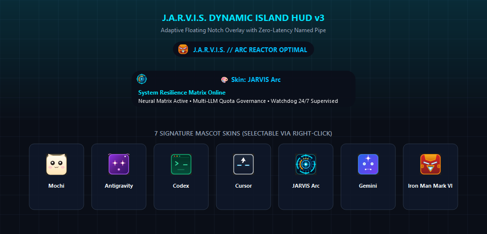
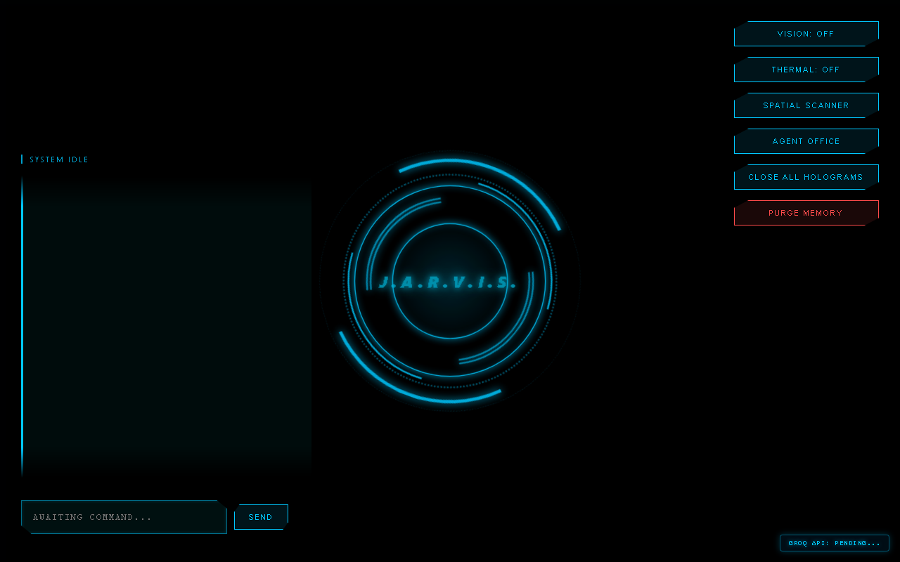

<div align="center">

# ⚡ J.A.R.V.I.S. // NEURAL MATRIX ⚡
### *Nachapol Industries Advanced Super AGI Mainframe*

[](https://www.python.org/)
[](https://microsoft.com)
[](LICENSE)
[](https://github.com/sanior09/JARVIS-Mainframe/actions)
[](#)

<p align="center">
  <b>ระบบผู้ช่วยอัจฉริยะแบบ Autonomous AGI ระดับวิศวกรรมสำหรับ Windows</b><br>
  Dynamic Island Desktop HUD • สภาสมองกล 6 ขุนพล • โต้ตอบด้วยเสียง Real-Time • AR Spatial Workbench
</p>

<p align="center">
  <a href="#highlights"><b>⚡ จุดเด่น</b></a> •
  <a href="#ai-council"><b>🏛️ สภา AI</b></a> •
  <a href="#quick-start"><b>🚀 วิธีติดตั้ง</b></a> •
  <a href="#interfaces"><b>🖥️ ส่วนติดต่อผู้ใช้</b></a> •
  <a href="#subsystems"><b>🛠️ ระบบย่อย</b></a> •
  <a href="#skills-ecosystem"><b>🧩 ทักษะ Agentic</b></a> •
  <a href="#dev-note"><b>📝 บันทึกผู้พัฒนา</b></a>
</p>

</div>

---

<a id="highlights"></a>
## ⚡ ฟีเจอร์หลักเด่นประจำระบบ (System Highlights)

| 🏝️ Desktop Dynamic Island & AR | 🏛️ Multi-Agent Swarm Council |
| :--- | :--- |
| • หน้าปัด HUD ลอยตัวสไตล์ Cyberpunk พร้อม 7 มาสคอตสกิน<br>• AR Spatial Workbench สแกนวัตถุบนโต๊ะแบบ Real-time พร้อมการ์ด Bento ข้อมูล | • ระดมพลสภา AI 6 ขุนพล ประชุมคู่ขนานความเร็วแสง (~1s)<br>• สังเคราะห์กลยุทธ์และตรวจทานโค้ดตามความเชี่ยวชาญเฉพาะด้าน |
| 🎙️ Real-Time Voice & Optical HUD | 🤖 Autonomous Computer Operator |
| • เสียงพากย์ภาษาไทยเป็นธรรมชาติ พร้อมระบบ VAD Barge-In ตัดบทได้ทันที<br>• หน้าต่างกล้อง Web HUD ขยายเต็มจอภาพ (100vw × 100vh) ส่องโต๊ะทำงาน | • สแกนหน้าจอคอมพิวเตอร์และคลิกเมาส์/พิมพ์คีย์บอร์ด Windows อัตโนมัติ<br>• ทำงานเบื้องหลังพร้อมระบบความปลอดภัย Failsafe Watchdog 24/7 |

---

<a id="architecture"></a>
## 📐 แผนผังสถาปัตยกรรม (System Architecture Blueprint)
เปิดไฟล์ **[`web/jarvis_architecture.html`](web/jarvis_architecture.html)** บนเบราว์เซอร์ เพื่อดูแผนผังการทำงานแบบ Interactive (Zero-Overlap Pipeline):

<p align="center">
  
</p>

---

<a id="ai-council"></a>
## 🏛️ สภาสมองกล 6 ขุนพล (Multi-Agent Swarm Council)
เมื่อพบโจทย์วิศวกรรมที่ซับซ้อน ระบบจะเปิดการประชุมสภา AI แบบคู่ขนาน (**Parallel ThreadPool Deliberation**) เพื่อรวบรวมมุมมองเฉพาะทางและสังเคราะห์คำตอบที่ดีที่สุด:

| สมาชิกสภา | บทบาทหลัก (Role) | ขอบเขตความเชี่ยวชาญ (Specialty) |
| :---: | :--- | :--- |
| 👔 **J.A.R.V.I.S.** | **Council President** | ประธานสภา วางแผนแม่บท สังเคราะห์มุมมอง และกำกับความปลอดภัย |
| 👠 **F.R.I.D.A.Y.** | **Technical Lead** | สถาปัตยกรรมโค้ด วิศวกรรมซอฟต์แวร์ และการคำนวณวงจรไฟฟ้า |
| 🛡️ **V.E.R.O.N.I.C.A.** | **Tactical Sentinel** | ตรวจสอบความปลอดภัย ควบคุมเพดาน RAM/CPU ป้องกันระบบโอเวอร์โหลด |
| 🕶️ **E.D.I.T.H.** | **Strategic Intel** | วิเคราะห์ทฤษฎีเกม ประเมินความเสี่ยง และคาดการณ์แต้มต่อสูงสุด |
| 🔧 **U. (ยู)** | **Vision & Maintenance** | วิเคราะห์ภาพหน้าจอ เคลียร์ไฟล์แคช และบำรุงรักษาฐานข้อมูล |
| 🧯 **D.U.M.-E. (ดัม-อี)** | **Hardware & Safeguard** | ควบคุมเมาส์/คีย์บอร์ด OS, ระบบ Watchdog และตัดความร้อนฉุกเฉิน |

---

<a id="quick-start"></a>
## 🚀 วิธีติดตั้งและเริ่มใช้งาน (Quick Start)

### ขั้นตอนที่ 1: ติดตั้ง Dependencies
```bash
git clone https://github.com/sanior09/JARVIS-Mainframe.git
cd JARVIS-Mainframe
pip install -r requirements.txt
```

### ขั้นตอนที่ 2: ตั้งค่าสภาพแวดล้อมและ API Keys (`.env`)
คัดลอกไฟล์ `.env.example` เป็น `.env` และระบุคีย์บริการที่ท่านต้องการใช้งาน:
```env
# ━━━ 🧠 AI Neural Providers ━━━
GROQ_API_KEY=your_groq_api_key
GROQ_MODEL=openai/gpt-oss-120b
GROQ_FAST_MODEL=qwen/qwen3.8-27b
GEMINI_API_KEY=your_gemini_api_key
GEMINI_MODEL=gemini-3.6-flash

# ━━━ 🎙️ Audio & Streaming STT ━━━
DEEPGRAM_API_KEY=your_deepgram_api_key

# ━━━ 🏠 Smart Home & IoT (Home Assistant) ━━━
HOME_ASSISTANT_URL=http://homeassistant.local:8123
HOME_ASSISTANT_TOKEN=your_token

# ━━━ 🌐 External APIs ━━━
OPENWEATHER_API_KEY=your_weather_key
YOUTUBE_API_KEY=your_youtube_key

# ━━━ 📲 LINE Messaging & Remote Webhook ━━━
LINE_CHANNEL_ACCESS_TOKEN=your_line_token
LINE_CHANNEL_SECRET=your_line_secret
NGROK_PUBLIC_URL=https://your-domain.ngrok-free.app

# ━━━ ✉️ Gmail & Notifications ━━━
EMAIL_USER=your_email@gmail.com
EMAIL_PASS=xxxx xxxx xxxx xxxx

# ━━━ 👤 User Identity & OS Controls ━━━
OWNER_NAME=เจ้านาย
COMPUTER_CONTROL_MODE=background
```
> [!TIP]
> **เริ่มใช้งานอย่างรวดเร็ว (Quick Kickstart):** ระบุเพียง `GROQ_API_KEY` และ `GEMINI_API_KEY` ก็สามารถสั่งการสมองกลหลักได้ทันที ส่วน API คีย์บริการเสริมอื่น ๆ (Smart Home, LINE, พยากรณ์อากาศ) สามารถทยอยเติมได้ตามความต้องการใช้งานครับ

### ขั้นตอนที่ 3: เริ่มปฏิบัติการ (One-Click Boot)
ดับเบิลคลิกไฟล์ **`run_jarvis.bat`** หรือรันผ่านเทอร์มินัล:
```cmd
run_jarvis.bat
```
*(ระบบมี **`jarvis_watchdog.py`** คอยเฝ้าระวังโปรเซสและกู้คืนระบบแบบ Auto-Recovery ตลอด 24/7)*

<details>
<summary><b>⚙️ ทางเลือกเสริม: การติดตั้ง Local LLM และโหมดออฟไลน์ (Ollama)</b></summary>

<br>

หากต้องการใช้งานโหมดออฟไลน์หรือเฝ้าระวังจิตใต้สำนึก (Subconscious Engine) ติดตั้ง [Ollama](https://ollama.ai/) และเลือกโมเดลตามต้องการ:
- **โหมด Reflex ประหยัดแรมสูงสุด:** `ollama pull qwen:4b`
- **โหมด Uncensored สำหรับงาน Cybersecurity:** `ollama pull dolphin-llama3`
- **โหมดเขียนโค้ดและวิเคราะห์เชิงลึก:** `ollama pull qwen2.5-coder:7b`

</details>

---

<a id="interfaces"></a>
## 🖥️ ส่วนติดต่อผู้ใช้และแอปพลิเคชันเสริม (Companion Clients)

<a id="dynamic-island"></a>
### 🏝️ 1. Dynamic Island Desktop HUD v3
แผงควบคุมลอยตัว Cyberpunk เหนือหน้าต่าง Windows เชื่อมต่อผ่าน Named Pipe ความหน่วงต่ำ:
```bash
python modules/dynamic_island.py
```
- **7 Mascot Skins:** สลับได้ทันทีผ่านคลิกขวา (JARVIS Arc, Mochi, Codex, Cursor, Gemini, Iron Man, Antigravity)
- **Drag & Drop Ingestion:** ลากไฟล์/เอกสารมาหย่อนใส่ HUD เพื่อให้ AI สรุปและวิเคราะห์ทันที
- **AI Quota Gauge:** มอนิเตอร์โควตา API (Groq, Gemini, Ollama) แบบเรียลไทม์

<p align="center">
  
</p>

<a id="mobile-app"></a>
### 📱 2. Mobile Companion App & Web Portal
- **Mobile Companion (React Native / Expo):** `cd jarvis-mobile && npx expo start` — ควบคุม สั่งงานด้วยเสียง และส่งภาพวิเคราะห์จากสมาร์ตโฟน
- **Web Hologram Portal (`http://localhost:5050`):** แผงมอนิเตอร์ภาพรวมระบบ, Optical Camera Feed เต็มหน้าจอ และ AR Workbench

<p align="center">
  
</p>

---

<a id="subsystems"></a>
## 🛠️ รายละเอียดระบบย่อย (Subsystems Overview)

<details>
<summary><b>คลิกเพื่อดูรายละเอียดสถาปัตยกรรมระบบย่อยทั้ง 8 โมดูล</b></summary>

<br>

1. **🧠 Cognitive & Thought Engine:** จำลองสารสื่อประสาทชีวภาพ (Dopamine, Cortisol) ปรับสมาธิตามโหลดเครื่อง พร้อมระบบ Visual Screen Awareness ตรวจจับหน้าจอแบบไม่ส่งเสียงรบกวนเวลาดูวิดีโอ
2. **📊 AI Quota Governor:** ติดตาม Token/RPM/TPM แบบเรียลไทม์ และสลับโมเดลอัตโนมัติ (Fallback Routing) เมื่อติด Limit
3. **🎙️ Low-Latency Voice Engine:** Microsoft Edge Neural TTS ควบคู่กับ VAD Barge-In ตัดเสียงพูดแทรกใน 50ms และ Deepgram Streaming STT
4. **🤖 Windows Desktop Operator:** ควบคุมเมาส์/คีย์บอร์ด วิเคราะห์ปุ่ม UI และมีเลเยอร์ Laser Grid Takeover ขณะทำงานอัตโนมัติ
5. **👁️ Vision & Spatial Workbench:** MediaPipe Hand Tracking ควบคุมแบบไร้สัมผัส พร้อม AR Workbench สแกนบอร์ดวงจรและอุปกรณ์บนโต๊ะ
6. **🛡️ System Resilience & Auto-Healer:** Watchdog เฝ้าระวังตลอด 24 ชม., Code Sentinel สแกน AST ป้องกันคำสั่งอันตราย และระบบแพตช์โค้ดฉุกเฉินอัตโนมัติ
7. **🕵️ Subconscious & Cyber Guard:** เฝ้าระวังฮาร์ดแวร์ทุก 15 วินาที พร้อมสลับเข้าโหมด Local Uncensored Model อัตโนมัติเมื่อทำ Ethical Pentesting
8. **🎬 Multimedia Automation:** เชื่อมต่อ CapCut Desktop สำหรับตัดต่อวิดีโอ และ ComfyUI สำหรับสร้างภาพ AI

</details>

---

<a id="skills-ecosystem"></a>
## 🧩 คลังทักษะ Agentic เฉพาะทาง (The 12 Flagship Protocols)

<details>
<summary><b>คลิกเพื่อดูคลัง 12 เสาหลักทักษะ Agentic ใน `.agents/skills/`</b></summary>

<br>

| เสาหลัก | รายชื่อทักษะ (Skill) | หน้าที่และความสามารถหลัก |
| :--- | :--- | :--- |
| **System Core** | [`jarvis-module-scaffolder`](.agents/skills/jarvis-module-scaffolder/SKILL.md) | มาตรฐานขยายฟังก์ชันและโมดูลใหม่แบบ Decoupled ไม่ให้ไฟล์หลักบวม |
| | [`python-concurrency-guardian`](.agents/skills/python-concurrency-guardian/SKILL.md) | ควบคุม Thread Safety, Mutex Locks และ Graceful Shutdown ใน 1 วินาที |
| | [`pytest-mock-master`](.agents/skills/pytest-mock-master/SKILL.md) | มาตรฐาน Automated Test Suite จำลอง WMI, Audio และ Camera ครบ 100% |
| | [`swarm-council-orchestrator`](.agents/skills/swarm-council-orchestrator/SKILL.md) | บริหารการระดมพลสภา 6 ขุนพลสมองกล และฉันทามติ Tree of Thoughts |
| **Autonomous Ops** | [`computer-use-controller`](.agents/skills/computer-use-controller/SKILL.md) | จำลองการควบคุม Windows OS, คำนวณพิกัด Multi-Monitor และ Failsafe |
| | [`autonomous-self-healer`](.agents/skills/autonomous-self-healer/SKILL.md) | ตรวจสอบ Stack Trace ข้อผิดพลาดและ Hot-Patch โค้ดฉุกเฉินไร้ Downtime |
| | [`cyber-recon-spectre`](.agents/skills/cyber-recon-spectre/SKILL.md) | สแกนพอร์ตเครือข่าย วิเคราะห์คลื่น Wi-Fi และสลับสู่ Local Uncensored |
| **Sensory & Vision** | [`neural-audio-dsp`](.agents/skills/neural-audio-dsp/SKILL.md) | ตัดบทพูดแทรก VAD Barge-In และประมวลผลเสียง Real-Time WebSocket |
| | [`holographic-gesture-vision`](.agents/skills/holographic-gesture-vision/SKILL.md) | วิเคราะห์ท่าทางมือ 3D ด้วย MediaPipe และตรวจจับรอยต่อแผ่นวงจร PCB |
| | [`human-grade-web-designer`](.agents/skills/human-grade-web-designer/SKILL.md) | มาตรฐานดีไซน์ Web UI ระดับพรีเมียม ปราศจากเทมเพลต AI ซ้ำซาก |
| **Living-Room IoT** | [`iot-home-nexus`](.agents/skills/iot-home-nexus/SKILL.md) | ควบคุม Home Assistant REST/WebSocket และไมโครคอนโทรลเลอร์ ESP32 |
| | [`smart-tv-adb-controller`](.agents/skills/smart-tv-adb-controller/SKILL.md) | ควบคุม Android TV ไร้สาย ปลดระวาง Bloatware และติดตั้ง Clean Launcher |

</details>

---

<a id="roadmap"></a>
## 🚀 แผนพัฒนาสู่อนาคต (ASI Roadmap)
- ✅ **1. Autonomous Evolution:** ตกผลึกความรู้และปรับปรุงสถาปัตยกรรมอัตโนมัติช่วงดึก
- ✅ **2. Swarm Intelligence:** การประชุมสภา AI แบบคู่ขนานความหน่วงต่ำ (~1s)
- ✅ **3. Cognitive Loop & Subconscious:** ตรวจจับอารมณ์และเฝ้าระวังฮาร์ดแวร์เชิงรุก
- ⏳ **[PENDING] 4. Physical Embodiment:** เชื่อมต่อระบบหุ่นยนต์และแพลตฟอร์ม ROS2
- ⏳ **[PENDING] 5. Multi-Modal Omniscience:** บูรณาการเครือข่ายเซ็นเซอร์ IoT อัจฉริยะทั่วห้องทดลอง

---

<a id="dev-note"></a>
## 📝 บันทึกจากผู้พัฒนา & การให้เครดิต (Credits)

> [!NOTE]
> โปรเจกต์นี้เริ่มต้นขึ้นเพื่อใช้งานจริงในชีวิตประจำวัน ออกแบบให้ประหยัดทรัพยากรและรันได้บนคอมพิวเตอร์ทั่วไป ยินดีต้อนรับทุกท่านร่วม Fork, ต่อยอด หรือส่ง Pull Request ได้เต็มที่ครับ! — **Nachapol Industries**

หากนำโปรเจกต์นี้ไปพัฒนาต่อยอดหรือเผยแพร่ กรุณาให้เครดิต **Nachapol Industries** พร้อมแนบลิงก์กลับมายังคลังต้นฉบับ [https://github.com/sanior09/JARVIS-Mainframe](https://github.com/sanior09/JARVIS-Mainframe) ภายใต้สัญญาอนุญาต [MIT License](LICENSE)

<br>
<div align="center">
  <sub>Architected with precision by <b>Nachapol Industries</b> • Mainframe Integrity: <b>100.0% OPTIMAL</b></sub>
</div>
