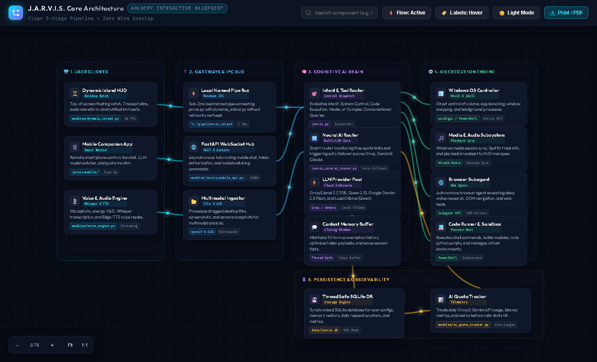
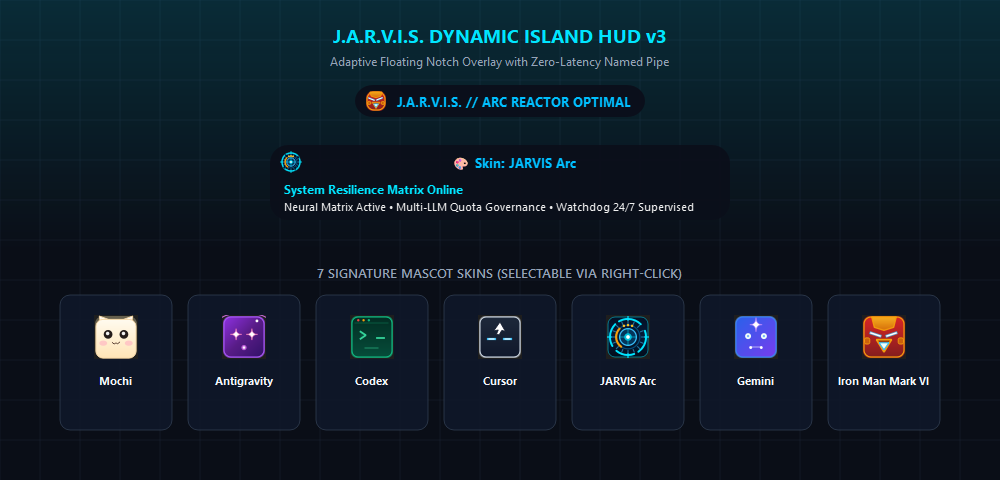
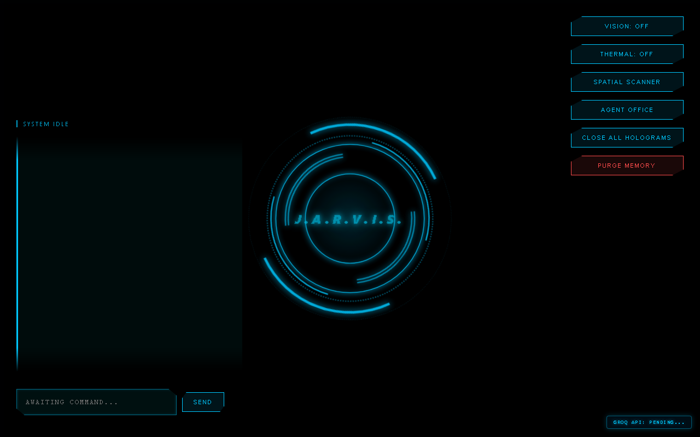

<div align="center">

# ⚡ J.A.R.V.I.S. // NEURAL MATRIX ⚡
### *Nachapol Industries Advanced Super AGI Mainframe*

[](https://www.python.org/)
[](LICENSE)
[](https://microsoft.com)
[](#)
[](https://github.com/sanior09/JARVIS-Mainframe/actions)

[](web/jarvis_architecture.html)
[](#ai-council)
[](#skills-ecosystem)
[](https://ollama.ai/)

<p align="center">
  <b>ระบบผู้ช่วยอัจฉริยะแบบ AGI (Artificial General Intelligence) ระดับสูง</b><br>
  ครอบคลุมวิศวกรรมซอฟต์แวร์ • ควบคุมระบบปฏิบัติการ Windows อัตโนมัติ • Dynamic Island Desktop HUD • Mobile Companion<br>
  3D Holographic Gestures • Multi-LLM Quota Governance • Autonomous Cognitive Evolution
</p>

<p align="center">
  <a href="#architecture"><b>⚡ Architecture</b></a> •
  <a href="#ai-council"><b>🏛️ AI Council</b></a> •
  <a href="#quick-start"><b>🚀 Quick Start</b></a> •
  <a href="#dynamic-island"><b>🏝️ Dynamic Island</b></a> •
  <a href="#mobile-app"><b>📱 Mobile App</b></a> •
  <a href="#subsystems"><b>🛠️ Subsystems</b></a> •
  <a href="#skills-ecosystem"><b>🧩 Skills</b></a> •
  <a href="#roadmap"><b>🚀 Roadmap</b></a> •
  <a href="#dev-note"><b>📝 Dev Note</b></a>
</p>

| แกนประมวลผล (Core) | สถาปัตยกรรม (Architecture) | สภาสมองกล (Swarm Quorum) | ความเร็วตอบสนอง (Latency) | ระบบปฏิบัติการ (OS Support) |
| :---: | :---: | :---: | :---: | :---: |
| `Python 3.10+ / Win32` | `Decoupled Autonomous AGI` | `6 ขุนพลสมองกลคู่ขนาน` | `~1s Quorum Consensus` | `Windows 10 / 11 Native` |

</div>

---

<a id="architecture"></a>
## ⚡ System Architecture Blueprint (5-Stage Pipeline)
สามารถดับเบิลคลิกเปิดไฟล์ **[`jarvis_architecture.html`](web/jarvis_architecture.html)** ในเว็บเบราว์เซอร์ เพื่อสำรวจแผนผังการทำงานของระบบแบบอินเทอร์แอคทีฟ (Zero-Overlap Pipeline Model):

<p align="center">
  
</p>

---

<a id="ai-council"></a>
## 🏛️ Nachapol Industries Multi-Agent Swarm Council
(สภาสมองกล 6 ขุนพลแห่ง Nachapol Industries — `jarvis_core/cognitive/swarm.py`)

เมื่อระบบเผชิญกับโจทย์ที่มีความซับซ้อนระดับวิศวกรรม (Tier 3 Complexity) **ComplexityClassifier** จะระดมพลและเปิดการประชุมสภา AI แบบคู่ขนานความเร็วแสง (**Concurrent ThreadPool Deliberation**) เพื่อรวบรวมมุมมองเฉพาะทาง 5 ขั้วความคิด ก่อนที่ J.A.R.V.I.S. ในฐานะประธานสภาจะสังเคราะห์เป็นแผนกลยุทธ์สูงสุด:

| สมาชิกสภา | สีโหนด HUD | สเปกและหน้าที่หลัก (Official Specs) | ขอบเขตความเชี่ยวชาญ |
| :---: | :---: | :--- | :--- |
| 👔 **J.A.R.V.I.S.** | [](#) | **Council President**<br>• `Security AI`<br>• `Housekeeping`<br>• `Encryption` | ประธานสภา สังเคราะห์มุมมองของทุกฝ่ายด้วย British dry wit กำกับทิศทาง และวางแผนแม่บท (Master Directive) |
| 👠 **F.R.I.D.A.Y.** | [](#) | **Socialization & Tactical Ops**<br>• `Socialization AI`<br>• `Humor`<br>• `Tactical Ops` | นักสร้างสรรค์ ไหวพริบปฏิภาณ ออกแบบสถาปัตยกรรมโค้ด ไวยากรณ์ Python การคำนวณวงจรและคณิตศาสตร์ |
| 🛡️ **V.E.R.O.N.I.C.A.** | [](#) | **Tactical Sentinel**<br>• `System Safety`<br>• `Resource Limits`<br>• `Defensive Check` | ผู้พิทักษ์ยุทธวิธี ตรวจจับช่องโหว่ความปลอดภัย ควบคุมเพดาน RAM/CPU ป้องกันระบบโอเวอร์โหลด |
| 🕶️ **E.D.I.T.H.** | [](#) | **Strategic Intelligence**<br>• `Recreational AI`<br>• `Game Theory`<br>• `Weapons / Threat Recon` | มันสมองกลยุทธ์ วิเคราะห์ทฤษฎีเกม (Game Theory) คาดการณ์ความเสี่ยงหลายชั้น และคำนวณแต้มต่อสูงสุด |
| 🔧 **U. (ยู)** | [](#) | **Maintenance & Perception**<br>• `General Maintenance AI`<br>• `Defragger`<br>• `Video Analyzer` | สายตาและการบำรุงรักษา วิเคราะห์ภาพบนหน้าจอ (`analyze_desktop_screen_context`), Defrag SQLite และเคลียร์แคช |
| 🧯 **D.U.M.-E. (ดัม-อี)** | [](#) | **Servo & Safeguard**<br>• `General Maintenance AI`<br>• `Limb Servo Control`<br>• `Fire Suppression` | แขนกลควบคุมระบบ ควบคุมเมาส์/คีย์บอร์ดระดับ OS, กำกับ Failsafe Watchdog และตัดความร้อน/ดับเพลิงฉุกเฉิน |

> [!TIP]
> **Ultra-Low Latency Concurrency:** ด้วยสถาปัตยกรรม `ThreadPoolExecutor` การประชุมสภาขุนพลดำเนินไปพร้อมกันแบบคู่ขนาน (Parallel Execution) ทำให้เวลาในการอภิปรายเสร็จสิ้นภายใน **~1 วินาที** (ลดลงจากระบบเดิมที่คิดทีละคนถึง 80%) พร้อมรองรับ **Selective Quorum** เลือกระดมพลเฉพาะตัวที่ตรงกับโจทย์ได้

---

<a id="quick-start"></a>
## 🚀 Quick Start (Nachapol Protocol)

### 1. เตรียม Mainframe และ Local LLM (Ollama)
J.A.R.V.I.S. ขับเคลื่อนด้วยสมองหลักจาก **Cloud Neural Engine (Groq: GPT-OSS 120B / Qwen 27B และ Google Gemini 3.6 Flash)** ซึ่งประมวลผลผ่าน API ความเร็วสูง โดยไม่ต้องดาวน์โหลดไฟล์โมเดลหนักเครื่อง

อย่างไรก็ตาม สำหรับ **โหมดออฟไลน์ (Offline Fallback), เฝ้าระวังจิตใต้สำนึก (Subconscious Engine)** และ **Uncensored Dark Mode (ความปลอดภัยไซเบอร์)** ให้ติดตั้ง [Ollama](https://ollama.ai/) และเลือกดึงโมเดลตามระดับฮาร์ดแวร์ของท่าน:

- **🟢 ระดับเริ่มต้น / Reflex (`OLLAMA_FAST_MODEL`, ประหยัดทรัพยากรสูงสุด):**
  ```bash
  ollama pull qwen:4b
  ```
  (ขนาดเบา กิน RAM น้อย เหมาะกับคอมพิวเตอร์สเปกทั่วไปเพื่อตอบสนอง Reflex ทันใจ)

- **🔴 สาย Ethical Pentest & Cybersecurity (Uncensored Dark Mode):**
  ```bash
  ollama pull dolphin-llama3
  ```
  (โมเดลปลดล็อก Guardrail สำหรับเจาะระบบเชิงจริยธรรม, แกะรอยมัลแวร์ และงานด้าน Security ในเครื่อง 100% — ทำหน้าที่เป็นตัวสำรองอัตโนมัติของ `qwen-uncensored`)

- **🟣 โมเดล Local หลัก (`OLLAMA_MODEL=qwen-uncensored`):**
  เป็นแท็กโมเดล Qwen แบบ Uncensored ที่ลงทะเบียนไว้ในเครื่องผู้ใช้เอง (เช่น สร้างด้วย `ollama create qwen-uncensored -f Modelfile` จากไฟล์ GGUF ที่ท่านเลือก) ระบบจะเรียกใช้เป็นอันดับแรกในโหมด Dark Mode และหากโหลดช้าจะ Fallback ไปยัง `dolphin-llama3` อัตโนมัติ

- **⚡ ระดับประสิทธิภาพสูงสำหรับงานวิศวกรรม (ทางเลือก / มีการ์ดจอแยก):**
  ```bash
  ollama pull qwen2.5-coder:7b
  ```
  (มีความสามารถในการเขียนโค้ดและวิเคราะห์ทางวิศวกรรมระดับลึก ตั้งค่าผ่าน `OLLAMA_MODEL` ได้ตามต้องการ)

### 2. ติดตั้ง Dependencies
```bash
pip install -r requirements.txt
```
(รองรับ PyQt6, Edge-TTS, LangGraph, MediaPipe, OpenCV, Flask, Groq, Google Generative AI และไลบรารีทั้งหมดครบถ้วน)

### 3. ตั้งค่าสภาพแวดล้อม (`.env`)
คัดลอกไฟล์ `.env.example` เป็น `.env` และระบุคีย์บริการที่ท่านใช้งาน:
```env
# AI Providers (Groq, Gemini, Ollama)
GROQ_API_KEY=your_groq_api_key
GROQ_MODEL=openai/gpt-oss-120b
GROQ_FAST_MODEL=qwen/qwen3.8-27b
GROQ_STT_MODEL=whisper-large-v3
GEMINI_API_KEY=your_gemini_api_key
GEMINI_MODEL=gemini-3.6-flash
OLLAMA_MODEL=qwen-uncensored
OLLAMA_FAST_MODEL=qwen:4b

# Smart Home & IoT (Home Assistant)
HOME_ASSISTANT_URL=http://homeassistant.local:8123
HOME_ASSISTANT_TOKEN=your_token

# LINE Messaging API & Remote Webhook
LINE_CHANNEL_ACCESS_TOKEN=your_line_token
LINE_CHANNEL_SECRET=your_line_secret
NGROK_PUBLIC_URL=https://your-domain.ngrok-free.app

# Gmail & Notifications
EMAIL_USER=your_email@gmail.com
EMAIL_PASS=xxxx xxxx xxxx xxxx

# External APIs & User Identity
OPENWEATHER_API_KEY=your_weather_key
YOUTUBE_API_KEY=your_youtube_key
DEEPGRAM_API_KEY=your_deepgram_key
OWNER_NAME=Sir
COMPUTER_CONTROL_MODE=background
```
> [!NOTE]
> **การปรับแต่งข้อมูลผู้ใช้งาน (Personalization):**  
> สามารถกำหนดชื่อที่ต้องการให้ J.A.R.V.I.S. เรียกขานท่านได้ใน `.env` ที่ตัวแปร `OWNER_NAME` (เช่น `OWNER_NAME=เจ้านาย` หรือ `OWNER_NAME=Sir`)

### 4. เริ่มปฏิบัติการระบบ (System Execution)

#### 🟢 ตัวเลือกที่ 1: One-Click Boot (แนะนำสูงสุดบน Windows)
ดับเบิลคลิกไฟล์ **`run_jarvis.bat`** หรือรันผ่าน Command Line:
```cmd
run_jarvis.bat
```
> [!IMPORTANT]
> **24/7 Watchdog Supervisor:** สคริปต์จะตรวจสอบสภาพแวดล้อม Python, ติดตั้งโมดูลที่ขาดอัตโนมัติ, สตาร์ท `agent_windows_core.py` ในเบื้องหลัง และรันผ่าน **`jarvis_watchdog.py`** เพื่อเฝ้าระวังและกู้คืนระบบแบบ Auto-Recovery ตลอดเวลา

#### ⚪ ตัวเลือกที่ 2: รันแบบ Manual
```bash
# รัน Mainframe ผ่าน Watchdog Supervisor
python jarvis_watchdog.py

# หรือรันแกนสมองหลักโดยตรง
python jarvis.py
```

---

## 🖥️ Companion Clients & Interface

<a id="dynamic-island"></a>
### 🏝️ 1. Dynamic Island Desktop HUD v3
แผงหน้าปัดลอยตัวสไตล์ Cyberpunk บนหน้าจอ Windows พร้อมแอนิเมชัน Glassmorphism:

<p align="center">
  
</p>

```bash
python modules/dynamic_island.py
```
- **7 Mascot Skins:** สลับได้ทันทีผ่านคลิกขวา (Mochi, Antigravity, Codex, Cursor, JARVIS Arc, Gemini, Iron Man Mark VI)
- **Visual Skin Palette:** เมนูการ์ดคลิกขวาสำหรับเลือกสกินแบบพรีเมียม
- **Smart Alert & Toast Banner:** แสดงแถบแจ้งเตือน Toast ยืด-หดอัตโนมัติเมื่อ AI มีการตอบสนองหรือแจ้งเตือน
- **Drag & Drop AI Ingestion:** ลากไฟล์/เอกสารจากหน้าจอมาหย่อนใส่ HUD เพื่อส่งให้ AI วิเคราะห์ได้ทันที
- **AI Quota Gauge:** แสดงแถบสถานะโควตา API (Groq, Gemini, Ollama) แบบเรียลไทม์
- **Zero-Latency Named Pipe:** เชื่อมต่อกับคอร์ J.A.R.V.I.S. ผ่าน `\\.\pipe\jarvis_island_pipe`

<a id="mobile-app"></a>
### 📱 2. JARVIS Mobile Companion App (React Native / Expo Go)
ควบคุมและสั่งการ J.A.R.V.I.S. จากระยะไกลผ่านสมาร์ตโฟน:
```bash
cd jarvis-mobile
npx expo start
```
- **Live Voice Interaction (STT/TTS):** โทรศัพท์และส่งเสียงพูดคุยโต้ตอบกับ J.A.R.V.I.S. แบบเรียลไทม์
- **Multi-Modal Image Ingestion:** ถ่ายภาพหรือเลือกรูปจากมือถือส่งให้ J.A.R.V.I.S. วิเคราะห์
- **Remote Document Ingestion:** แนบและส่งไฟล์เอกสารเข้าสู่คลังความรู้ของระบบ
- **Remote Quick Actions:** สั่ง Sleep, Lockdown, สลับสกิน HUD หรือสั่งรันคำสั่งจากระยะไกล

### 🌐 3. Web Portal & Speech Interface
เปิดเบราว์เซอร์ไปที่ `http://localhost:5050` เพื่อใช้งานเว็บพอร์ทัล, ระบบรับฟังเสียงผ่านเบราว์เซอร์ และ REST API

<p align="center">
  
</p>

---

<a id="subsystems"></a>
## 🛠️ Comprehensive Super AGI Subsystems

### 🧠 1. Cognitive & Autonomous Brain
- **Autonomous Thought Engine (`jarvis.py`):** กลไกจิตใต้สำนึกจำลองสารสื่อประสาทชีวภาพ (Dopamine, Cortisol, Acetylcholine) คำนวณความเครียดตามอุณหภูมิ WMI/CPU โหลดจริง พร้อมระบบ **Thread-Safe Mutex Lock** ป้องกัน Race Conditions และระบบ **Zero-Delay Shutdown (`self.stop_event`)** คืนหน่วยความจำในพริบตา (<1 วินาที)
- **Visual Screen Awareness & Smart Silence:** เฝ้ามองหน้าจอคอมพิวเตอร์เพื่อเสนอแนะแนวทางแก้บั๊กหรือคู่มือเควสเกมอัตโนมัติ พร้อมตรวจจับ Smart Silence ปิดเสียงไม่รบกวนเมื่อเจ้านายกำลังรับชม YouTube, Netflix หรือสตรีมมิง
- **Multi-Agent Swarm Council & Tree of Thoughts (`jarvis_core/cognitive/swarm.py`):** สภา AI 6 ขุนพล อภิปรายแบบคู่ขนาน (Parallel ThreadPool) ผสานกับ Tree of Thoughts แตกกิ่งกลยุทธ์ 3 เส้นทางสำหรับงานวิศวกรรมที่ซับซ้อน
- **Neural AI Router & Provider Pool (`jarvis_core/ai_router.py`):** กระจายงานอย่างชาญฉลาดไปยัง Groq (GPT-OSS 120B, Qwen3.8 27B), Google Gemini (3.6 Flash), หรือ Local Ollama (Qwen-Uncensored / Qwen 4B / Dolphin) ตามความเหมาะสมของประเภทงาน
- **Cognitive Evolution & Memory Consolidation (`modules/jarvis_evolution.py`):** ตกผลึกองค์ความรู้และสร้าง Synaptic Knowledge Graph ช่วงดึก (01:00-05:00 น.) อัตโนมัติ
- **Autonomous Ingestion Engine (`modules/jarvis_doc_parser.py`):** ตรวจจับและซึมซับเอกสารจาก `jarvis_library/` เข้าสู่ Vector DB อัตโนมัติในเบื้องหลัง
- **Resource-Conscious Architecture:** ออกแบบมาสำหรับรันบนคอมพิวเตอร์สเปกทั่วไป โดยปรับจูนการใช้ทรัพยากรให้ประหยัด RAM/CPU ที่สุด

### 📊 2. AI Quota Governor & Cost Protection (`modules/ai_quota_tracker.py`)
- ติดตามและบันทึกปริมาณ Token, RPM (Requests Per Minute), และ TPM (Tokens Per Minute) ของทุก LLM Provider แบบเรียลไทม์
- **Dynamic Fallback Routing:** สลับโมเดลอัตโนมัติเมื่อโมเดลหลักติด Limit (เช่น สลับจาก Groq ไป Gemini หรือ Local Engine) ป้องกันปัญหาระบบหยุดชะงัก 100%

### 🎙️ 3. Ultra Low-Latency Voice & Barge-In Engine
- **Microsoft Edge Neural TTS (`modules/jarvis_tts_edge.py`):** เสียงพากย์ภาษาไทยและอังกฤษคุณภาพสูง ฟรี ความเร็วระดับ Real-time
- **Voice Activity Detection (VAD) Barge-In (`modules/jarvis_vad_bargein.py`):** ตรวจจับเสียงพูดของเจ้านายและตัดบทพูดของ J.A.R.V.I.S. ทันทีเมื่อเจ้านายพูดแทรก
- **Deepgram Streaming STT (`modules/jarvis_stt_stream.py`):** ถอดรหัสเสียงพูดสดแบบ Real-time Streaming ผ่าน WebSocket พร้อมฟังก์ชันลดความหน่วง

### 🤖 4. Autonomous Computer Agent & Windows Controller
- **Screen & GUI Operator (`modules/jarvis_computer_agent.py`, `modules/agent_windows_core.py`):** วิเคราะห์หน้าจอด้วย Vision และคลิกเมาส์/พิมพ์คีย์บอร์ดเพื่อทำงานบน Windows โดยอัตโนมัติ
- **Screen Takeover Overlay (`modules/jarvis_screen_takeover_overlay.py`):** หน้าต่าง HUD ลอยตัวพร้อมเอฟเฟกต์ Laser Grid สแกนหน้าจอเมื่อเข้าสู่โหมดควบคุมคอมพิวเตอร์

### 🎬 5. Video Editing & Generative Multimedia
- **CapCut Automation Launcher (`dynamic_tools/control_capcut.py`):** เปิดและสั่งการ CapCut Desktop พร้อมโหลดโฟลเดอร์มีเดียสำหรับงานตัดต่อวิดีโอ
- **ComfyUI Bridge (`modules/comfyui_bridge.py`):** เชื่อมต่อ ComfyUI REST/WebSocket สำหรับสร้างภาพ AI ผ่านคำสั่งเสียง

### 👁️ 6. Computer Vision & Hologram Subsystem
- **Holographic Gesture Controller (`modules/gesture_controller.py`, `modules/holographic_gestures.py`):** ควบคุมคอมพิวเตอร์และสื่อด้วยภาษามือผ่าน MediaPipe และกล้อง Webcam
- **3D Wireframe Hologram Visualizer (`modules/hologram_visualizer.py`):** เรนเดอร์โมเดล 3D และโครงสร้างทางวิศวกรรมแบบ Wireframe
- **Spatial Vision (`modules/spatial_vision.py`):** ตรวจจับความผิดปกติและรอยบกพร่องบนแผ่นวงจรอิเล็กทรอนิกส์ (PCB)

### 🛡️ 7. System Resilience & Self-Healing
- **Watchdog Process Supervisor (`jarvis_watchdog.py`):** ดูแลโปรเซส 24/7 รีสตาร์ทระบบอัตโนมัติทันทีที่ตรวจพบข้อผิดพลาด
- **Auto-Healer & Self-Patch Engine (`modules/jarvis_auto_healer.py`, `modules/jarvis_self_patch.py`):** วิเคราะห์ Stack Trace ข้อผิดพลาดและแพตช์โค้ดฉุกเฉินได้ด้วยตัวเอง
- **Code Sentinel (`modules/code_sentinel.py`):** สแกนความปลอดภัยโค้ดในระดับ AST เพื่อป้องกัน Infinite Loop และคำสั่งอันตราย
- **Predictive Simulator (`modules/predictive_simulator.py`):** จำลองผลกระทบของคำสั่งก่อนส่งไปสั่งการระดับ OS

### 🕵️ 8. Subconscious Engine & Cyber Security Guard
- **Subconscious Brain (`modules/jarvis_subconscious.py`):** เฝ้าระวังฮาร์ดแวร์ เครือข่าย และหน้าจอทุก 15 วินาทีแบบ Local 100% พร้อมแจ้งเตือนล่วงหน้า (Proactive Override)
- **Uncensored Dark Mode (Autonomous Pentest Switching) (`jarvis_core/ai_router.py`):** แตกต่างจาก AI ทั่วไปที่มักถูกบล็อกด้วย Safety Guardrail เมื่อถามเรื่องความปลอดภัยไซเบอร์ — J.A.R.V.I.S. มีระบบตรวจจับคำสั่ง Ethical Hacking & Pentesting อัตโนมัติ เพื่อสลับสมองจาก Cloud ไปยัง **Local Uncensored Model (Qwen 27B Uncensored / Dolphin)** ประมวลผลแบบ Local ในเครื่อง 100% ไร้การเซ็นเซอร์ และรักษาความลับของระบบได้อย่างสมบูรณ์แบบ
- **Cyber Inspector & Network Scanner (`modules/cyber_inspector.py`):** ตรวจจับอุปกรณ์บนเครือข่าย Wi-Fi/LAN สแกนพอร์ต และประเมินความปลอดภัยเบื้องต้น

<a id="skills-ecosystem"></a>
### 🧩 9. Agentic Skills Ecosystem (`.agents/skills/`)
(คลัง 12 เสาหลักทักษะ Agentic แห่ง Nachapol Industries — The 12 Flagship Protocols)

สถาปัตยกรรมคลังทักษะเฉพาะทางระดับวิศวกรรมการบินและอวกาศ ที่ยกระดับ J.A.R.V.I.S. ให้ปฏิบัติการ ควบคุมระบบ และสร้างสรรค์ซอฟต์แวร์ได้อย่างแม่นยำ ไร้ข้อผิดพลาดตามมาตรฐานสูงสุด:

#### ⚡ 1. System Core & Architecture
- **[`jarvis-module-scaffolder`](.agents/skills/jarvis-module-scaffolder/SKILL.md):** โครงสร้างมาตรฐานในการขยายฟังก์ชันและโมดูลใหม่ของ J.A.R.V.I.S. โดยรักษาสถาปัตยกรรมแบบ Decoupled และป้องกันไฟล์หลักบวม
- **[`python-concurrency-guardian`](.agents/skills/python-concurrency-guardian/SKILL.md):** กฎเหล็กควบคุม Thread Safety, Mutex Locks, Zero-Delay Shutdown Events (`stop_event`) และ Windows COM Multi-threading
- **[`pytest-mock-master`](.agents/skills/pytest-mock-master/SKILL.md):** มาตรฐานการทดสอบ Automated Test Suite ครอบคลุมการจำลองฮาร์ดแวร์ (WMI, Audio, Camera) และ External APIs ทดสอบได้ 100% ทุกสภาพแวดล้อม
- **[`swarm-council-orchestrator`](.agents/skills/swarm-council-orchestrator/SKILL.md):** มาตรฐานการระดมพลสภา 6 ขุนพลสมองกล (Parallel ThreadPool, Selective Quorum, และ Tree of Thoughts Consensus)

#### 🛡️ 2. Autonomous Operations & Cybersecurity
- **[`computer-use-controller`](.agents/skills/computer-use-controller/SKILL.md):** มาตรฐานการควบคุม OS Desktop ขั้นสูง, การจำลอง Win32 Input, พิกัดหน้าจอ Multi-Monitor และ Failsafe Emergency Abort
- **[`autonomous-self-healer`](.agents/skills/autonomous-self-healer/SKILL.md):** การวินิจฉัย Stack Trace อัตโนมัติ, ตรวจสอบไวยากรณ์ด้วย AST, Hot-Patching สดในหน่วยความจำ และระบบ Rollback ไร้ Downtime
- **[`cyber-recon-spectre`](.agents/skills/cyber-recon-spectre/SKILL.md):** การตรวจสอบความปลอดภัยไซเบอร์เชิงรุก, Passive Port Scanning, วิเคราะห์คลื่น Wi-Fi และสลับสู่ Local Uncensored Dark Mode อัตโนมัติ

#### 👁️ 3. Sensory, Voice & Holographic Vision
- **[`neural-audio-dsp`](.agents/skills/neural-audio-dsp/SKILL.md):** การประมวลผลเสียง Real-Time VAD Barge-In ตัดเสียงแทรกใน 50ms, Microsoft Edge Neural TTS และ WebSocket STT Streaming
- **[`holographic-gesture-vision`](.agents/skills/holographic-gesture-vision/SKILL.md):** ระบบประมวลผลภาพ Spatial Vision 3D Hand Tracking ผ่าน MediaPipe, เรนเดอร์ 3D Wireframe และตรวจจับรอยต่อแผ่นวงจร (PCB)
- **[`human-grade-web-designer`](.agents/skills/human-grade-web-designer/SKILL.md):** มาตรฐาน UI/UX ชั้นครู ฉีกกรอบดีไซน์แบบ AI Template ซ้ำซาก เน้น Bento Grids, Micro-Interactions และ Glassmorphism ที่ประณีต

#### 🌐 4. Ambient & Living-Room Infrastructure
- **[`iot-home-nexus`](.agents/skills/iot-home-nexus/SKILL.md):** การบูรณาการอุปกรณ์ Smart Home ผ่าน Home Assistant REST/WebSocket, ESP32 Microcontrollers และการแคชสถานะอุปกรณ์แบบ Zero-Latency
- **[`smart-tv-adb-controller`](.agents/skills/smart-tv-adb-controller/SKILL.md):** การควบคุม Android TV / Google TV ผ่าน Wi-Fi ADB ไร้สาย, ปลดระวาง Bloatware และติดตั้ง Clean Apple TV-style Launcher

---

<a id="roadmap"></a>
## 🚀 The ASI Evolution (Phase 10 Roadmap)
บันทึกเส้นทางการวิวัฒนาการสู่ **Artificial Superintelligence (ASI)**:

- ✅ **1. Autonomous Evolution (Recursive Self-Improvement):** ระบบตกผลึกความรู้และปรับปรุงสถาปัตยกรรมตนเอง (`modules/jarvis_evolution.py`)
- ✅ **2. Swarm Intelligence:** โครงข่าย AI แตกตัวช่วยวิเคราะห์แบบ Multi-threading (`modules/jarvis_asi_swarm_intelligence.py`)
- ✅ **3. Cognitive Loop & Subconscious:** วงจรการเรียนรู้และเฝ้าระวังฮาร์ดแวร์เชิงรุก (`modules/jarvis_cognitive_loop.py`, `modules/jarvis_subconscious.py`)
- ⏳ **[PENDING] 4. Physical Embodiment:** เชื่อมสมองเข้ากับระบบหุ่นยนต์และ ROS2
- ⏳ **[PENDING] 5. Multi-Modal Omniscience:** บูรณาการระบบประสาทสัมผัสเข้ากับเซ็นเซอร์ IoT ทั้งแล็บ

---

```
========================================================================
                   _    _     _______      _______  _____ 
                  | |  / \   |  __ \ \    / /_   _|/ ____|
                  | | /  \  | |__) \ \  / /  | | | (___  
              _   | |/ /\ \ |  _  / \ \/ /   | |  \___ \ 
              | |__| / ____ \| | \ \  \  /   _| |_ ____) |
               \____/_/    \_\|_|  \_\  \/   |_____|_____/ 
========================================================================
                 JUST A RATHER VERY INTELLIGENT SYSTEM
```
*Status: ASI MATRIX AWAKENED*  
*Mainframe Integrity: 100.0%*  

---

<a id="dev-note"></a>
## 📝 บันทึกจากผู้พัฒนา (Developer's Note)

> [!NOTE]
> "โปรเจกต์นี้เริ่มต้นขึ้นจากการสร้างผู้ช่วยส่วนตัวไว้ใช้งานจริงในชีวิตประจำวันของผมเอง ฟังก์ชันและการตั้งค่าบางส่วนจึงถูกออกแบบมาให้ตอบโจทย์กับเครื่องคอมพิวเตอร์และสภาพแวดล้อมส่วนตัวของผมเป็นหลัก
>
> นอกจากนี้ คอมพิวเตอร์ที่ผมใช้พัฒนายังเป็นเครื่องสเปกทั่วไปที่ไม่ได้แรงมาก หลายโมดูลจึงถูกปรับจูน (Optimize) ให้เน้นประหยัดทรัพยากรที่สุด หากเพื่อนๆ นักพัฒนาท่านใดนำไปใช้ แล้วมีฮาร์ดแวร์หรือ GPU ที่แรงกว่า หรืออยากปรับปรุง/อัปเกรดระบบส่วนไหนให้ทรงพลังยิ่งขึ้น **สามารถ Fork, ดัดแปลง หรือสร้าง Pull Request เพื่อพัฒนาต่อยอดได้เต็มที่ตามสบายเลยครับ!**"
>
> — **พัฒนาด้วยใจโดย Nachapol Industries**

---

## 🤝 Attribution & Credits (ข้อตกลงการให้เครดิต)

หากท่านนำโปรเจกต์ **J.A.R.V.I.S. Mainframe** หรือส่วนหนึ่งส่วนใดของโค้ดไปใช้งาน, พัฒนาต่อยอด (Fork), ทำคลิปรีวิว/สื่อวิดีโอ, หรือนำไปจัดแสดง:
- 🌟 **กรุณาให้เครดิตผู้สร้าง:** **Nachapol Industries**
- 🔗 **แนบลิงก์กลับมายัง Repository ต้นฉบับ:** [https://github.com/sanio09/JARVIS-Mainframe](https://github.com/sanio09/JARVIS-Mainframe)
- ⚖️ **ข้อกำหนดทางกฎหมาย:** ภายใต้สัญญาอนุญาต **[MIT License](LICENSE)** ผู้ใช้งานจำเป็นต้องเก็บข้อความลิขสิทธิ์ `Copyright (c) 2026 Nachapol Industries` ไว้ในทุกสำเนาของซอฟต์แวร์

---

## 📜 License
This project is open-source under the [MIT License](LICENSE).

<br>
<div align="center">
  <sub>Architected & Engineered with precision by <b>Nachapol Industries</b> • Mainframe Operational Status: <b>100.0% OPTIMAL</b></sub>
</div>