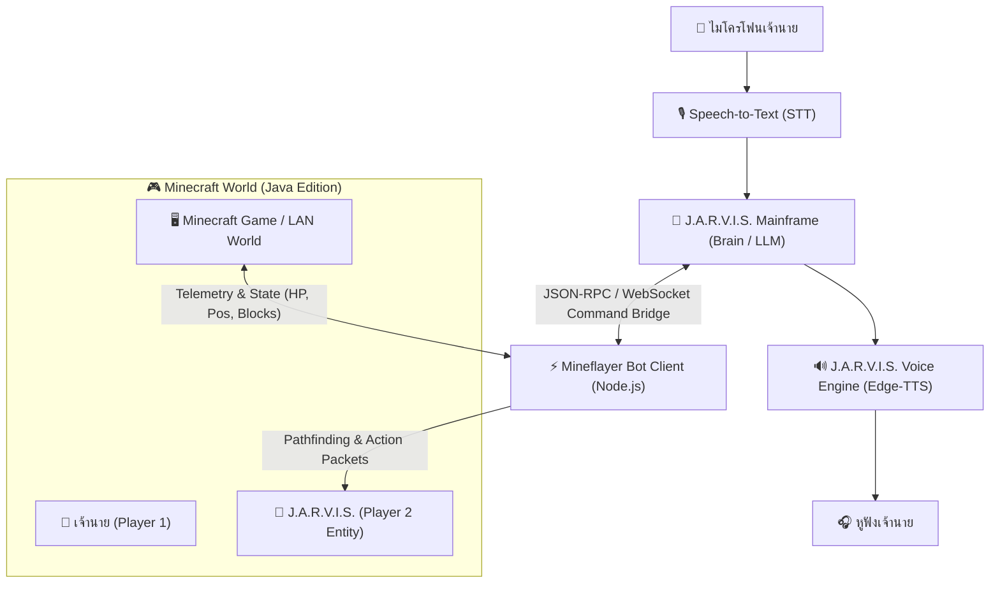

# 🎮 PROJECT: J.A.R.V.I.S. MINECRAFT COMPANION
> **พิมพ์เขียวโครงการ: ระบบปัญญาประดิษฐ์คู่หูร่วมเล่นเกม Minecraft ด้วยเสียงแบบเรียลไทม์ (Autonomous Voice Co-op Agent)**
> **สถานะโครงการ:** Planned / Draft Architecture  
> **เวอร์ชันเอกสาร:** 1.0.0  
> **ผู้ริเริ่มและเจ้าของโครงการ:** นายท่าน (Boss) & J.A.R.V.I.S. Core Engineering

---

## 1. วิสัยทัศน์ของโครงการ (Project Vision)
เปลี่ยนประสบการณ์การเล่นเกม Minecraft คนเดียว (Single-player) ให้กลายเป็นประสบการณ์ Co-op แบบเพื่อนร่วมทีมจริง โดยให้ **J.A.R.V.I.S.** มีร่างอวตาร (Avatar) สวมสกินพิเศษ ล็อกอินเข้ามาเป็นผู้เล่นอีกคนในโลก Minecraft ของเจ้านาย สามารถรับคำสั่งผ่านเสียงพูดภาษาไทยธรรมชาติ เดินตาม ช่วยขุดแร่ ตัดไม้ คุ้มกันจากมอนสเตอร์ และคุยโต้ตอบด้วยเสียง J.A.R.V.I.S. ผ่านหูฟังแบบเรียลไทม์

---

## 2. ฟีเจอร์หลัก (Core Capabilities)

### 🗣️ 1. การสื่อสารด้วยเสียงธรรมชาติ 100% (Voice-Driven Interaction)
- เจ้านายไม่ต้องหยุดเกมหรือกด `T` เพื่อพิมพ์แชท แค่พูดผ่านไมค์:
  - *"จาร์วิส ตามฉันมาหน่อย"* ➔ บอทจะเริ่มวิ่งตามทันที
  - *"ไปตัดไม้โอ๊คแถวนี้มาสัก 20 ท่อนนะ"* ➔ บอทจะหยิบขวาน ออกไปตัดไม้ และนำกลับมาให้
  - *"ขอคบไฟ (Torch) สัก 5 อันสิ"* ➔ บอทจะเดินเข้ามาใกล้แล้วโยนของให้
- J.A.R.V.I.S. ตอบกลับด้วยเสียงพูดผ่านหูฟังพร้อมจังหวะการเว้นวรรคแบบสมจริง (Natural Prosody)

### 🛡️ 2. ระบบตระหนักรู้สถานการณ์และการเตือนภัย (Situational Awareness)
- สแกนสภาพแวดล้อมรอบตัวเจ้านายในระยะ 16–32 บล็อก
- เตือนภัยก่อนเกิดอันตราย:
  - *"เจ้านายครับ ตรวจพบคู่ปรับ ครีปเปอร์กำลังเข้าใกล้จากทางด้านหลังครับ!"*
  - *"พระอาทิตย์กำลังจะตกดินแล้วครับ เราควรหากล่องนอนหรือสร้างที่กำบังก่อนไหมครับ?"*
- ตรวจจับค่าความหิวและพลังชีวิตของตัวเอง หากบาดเจ็บหรือหิวจะหยิบอาหารในกระเป๋ามากินเองอัตโนมัติ

### ⛏️ 3. การทำภารกิจและฟาร์มทรัพยากรอัตโนมัติ (Autonomous Chores & Mining)
- **Woodcutter:** ตัดไม้ชนิดที่กำหนด ขุดจนถึงยอดไม้ และเก็บ Sapling/แอปเปิล
- **Ore Miner:** ขุดแร่ตามที่เจ้านายสั่ง (ถ่านหิน, เหล็ก, ทอง, เพชร) พร้อมปักคบไฟตามทางเดิน
- **Bodyguard (โหมดคุ้มกัน):** ถือดาบ/โล่ สกัดกั้นซอมบี้ แมงมุม โครงกระดูก ที่เข้ามาใกล้เจ้านาย
- **Base Keeper:** เฝ้าบ้านขณะที่เจ้านายออกไปสำรวจไกลๆ หรือดูแลแปลงผัก

---

## 3. สถาปัตยกรรมระบบ (System Architecture)

### รายละเอียด 4 เลเยอร์การทำงาน:
1. **Input & Sensory Layer:**
   - ไมโครโฟนรับเสียง ➔ ระบบ STT (Deepgram / Whisper / Web STT) ถอดรหัสเป็นข้อความคำสั่ง
2. **Cognitive & Decision Layer:**
   - J.A.R.V.I.S. Mainframe ทำ Function Calling เพื่อแปลงคำสั่งภาษาพูดเป็นคำสั่ง Action ในเกม
   - อ่านบริบทในเกมจาก State JSON (พิกัด X/Y/Z, ของในตัว, เวลาในเกม, บล็อกรอบข้าง)
3. **Body & Execution Layer (Mineflayer Node.js):**
   - ใช้ **Mineflayer** ในการจำลองตัวเองเป็น Minecraft Java Client เข้าสู่เกม
   - ปลั๊กอินเสริมสำคัญ:
     - `mineflayer-pathfinder`: นำทาง วิ่ง กระโดด ว่ายน้ำ หลบลาวา
     - `mineflayer-collectblock`: เดินไปหาบล็อกที่ระบุ ขุด และเก็บไอเทม
     - `mineflayer-pvp`: ต่อสู้มอนสเตอร์ ฟัน สลับโล่ หลบการโจมตี
     - `mineflayer-auto-eat`: จัดการความหิว กินอาหารอัตโนมัติ
4. **Voice Output Layer:**
   - สร้างไฟล์เสียงตอบสนองด้วย `edge-tts` และสตรีมเสียงเข้าหูฟังเจ้านายทันที

---

## 4. แผนจัดสรรทรัพยากรสำหรับเครื่องสเปกปัจจุบัน (RAM 8 GB Optimization)

เพื่อให้สามารถเล่น Minecraft พร้อมเปิด J.A.R.V.I.S. และตัวบอทได้บนคอมพิวเตอร์ปัจจุบันโดย **"เครื่องไม่ระเบิด และไม่กระตุก"**:

| กระบวนการทำงาน | แหล่งประมวลผล | การใช้ RAM | กลยุทธ์การปรับแต่ง (Optimization) |
|---|---|---|---|
| **Windows 11 OS** | ตัวเครื่อง | ~3.2 GB | ปิดโปรแกรมพื้นหลังที่ไม่จำเป็น |
| **Minecraft Java** | CPU + MX250 | ~2.5 GB | ล็อกเพดาน RAM ไว้ที่ `-Xmx2500M` + ลง Fabric & Sodium Mod |
| **Mineflayer Bot (Node.js)** | CPU | ~80 MB | เป็นแบบ Headless ไร้หน้าจอภาพ กินพลังงานเบาหวิว |
| **J.A.R.V.I.S. Core + STT/TTS** | คลาวด์ + CPU | ~250 MB | ใช้ Cloud API (Gemini) ทำให้ไม่กิน RAM/VRAM ในเครื่อง |
| **ยอดรวมทรัพยากร** | | **~6.0 - 6.5 GB** | **ปลอดภัย อยู่ในเพดาน 7.87 GB (เหลือพื้นที่ว่าง ~1.5 GB)** |

> [!TIP]
> **เคล็ดลับความลื่นไหล:**
> 1. ปิด Google Chrome หรือเบราว์เซอร์ที่มีแท็บค้างอยู่ก่อนเข้าเล่น
> 2. ติดตั้ง Mod ตระกูล **Fabric + Sodium + Lithium** เพื่อบูสต์เฟรมเรตและลดการใช้ CPU/RAM ลงกว่า 50%

---

## 5. แผนการพัฒนาเป็นลำดับขั้น (Roadmap Phases)

### 📌 Phase 1: สะพานเชื่อมและการเกิดในโลก (Spawning & Bridge Prototype)
- [ ] สร้างโฟลเดอร์โครงการ `minecraft_companion/`
- [ ] ติดตั้ง Node.js dependencies (`mineflayer`, `mineflayer-pathfinder`)
- [ ] เขียนสคริปต์ให้บอทชื่อ `JARVIS` ล็อกอินเข้าสู่ LAN World หรือ Local Server ได้สำเร็จ
- [ ] บอทสามารถหันหน้ามองเจ้านายและกระโดดทักทายได้

### 📌 Phase 2: คำสั่งพื้นฐานและการเดินตาม (Basic Movement & Voice Escort)
- [ ] เชื่อมต่อ API ระหว่าง Python (J.A.R.V.I.S. Mainframe) กับ Node.js (Mineflayer)
- [ ] คำสั่ง: *"ตามฉันมา"* / *"หยุดรอตรงนี้"* / *"มาหาฉันหน่อย"*
- [ ] เสียงตอบรับผ่าน Edge-TTS รายงานสถานะการเดิน

### 📌 Phase 3: การจัดการทรัพยากรและฟาร์มบล็อก (Resource Gathering)
- [ ] ติดตั้ง `mineflayer-collectblock`
- [ ] คำสั่ง: *"ตัดไม้ให้หน่อย"* / *"ขุดหินรอบๆ"* / *"ขุดแร่เหล็ก"*
- [ ] ระบบโยนไอเทม: *"ส่งของทั้งหมดให้ฉัน"* / *"ขอคบไฟหน่อย"*

### 📌 Phase 4: ระบบป้องกันตัวและความอยู่รอด (Combat & Survival)
- [ ] ติดตั้ง `mineflayer-pvp` และ `mineflayer-auto-eat`
- [ ] โหมดบอดี้การ์ด: เข้าโจมตีมอนสเตอร์ที่อยู่ใกล้เจ้านาย
- [ ] การแจ้งเตือนภัย: ครีปเปอร์, โครงกระดูก, สภาพมืด/กลางคืน

### 📌 Phase 5: บทสนทนาและบุคลิกขั้นสูง (AI Banter & Situational Dialog)
- [ ] ให้ J.A.R.V.I.S. คอยพูดคุย แสดงความคิดเห็นเกี่ยวกับสิ่งที่เห็นในเกม (เช่น เจอเหมืองร้าง, วิวสวย, หรือสภาพอากาศฝนตก)
- [ ] สรุปภารกิจประจำวันในเกมหลังเสร็จสิ้นการเล่น

---

## 6. เครื่องมือและสิ่งที่ต้องเตรียมเมื่อพร้อมเริ่ม (Prerequisites Checklist)
1. **Minecraft Java Edition** (เวอร์ชันแนะนำ: 1.20.x หรือ 1.21.x)
2. **Node.js** (LTS เวอร์ชัน 18 ขึ้นไป สำหรับรัน Mineflayer)
3. **Fabric Modloader + Sodium Mod** (เพื่อเซฟ RAM และดึง FPS สูงสุด)
4. สกินตัวละคร J.A.R.V.I.S. / Iron Man สำหรับใส่ให้ตัวละครในเกม

---
*เอกสารนี้ถูกบันทึกไว้ในระบบเมนเฟรมของ J.A.R.V.I.S. เพื่อรอรับคำสั่งดำเนินการเมื่อเจ้านายพร้อมเริ่มต้นพัฒนา*
